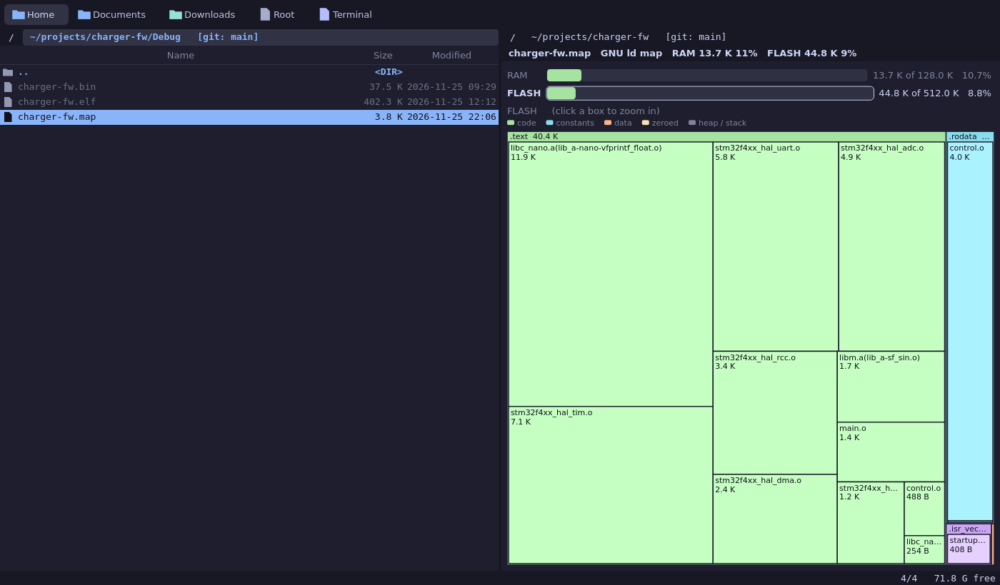

## Download (Windows)

`VimCommander-v0.4.0-windows-x64.zip` (below, under Assets): unzip anywhere and run `VimCommander.exe`. No Python needed; settings live in `config.json` next to the exe (unzipping over an older version keeps them). The exe isn't signed, so SmartScreen may warn the first time: *More info* → *Run anyway*.

On Linux and macOS, run from source (see the [README](https://github.com/vim4all/VimCommander#installation)).

## New

**Quick view of many more kinds of file** (`Ctrl-q`)
- **Source code in colour** (with Pygments): C, C++, Python, Rust, Go, JavaScript, shell, CMake and more. `:set nosyntax` turns it off.
- **CSV plots** (`zp`): one strip per column with zoom and min / max / mean / RMS. Click a column's name to plot the others against it, as a scatter if it doesn't rise. **LTspice `.raw`** results show as plots too.
- **Firmware memory maps** from GNU ld and Keil `.map` files and from `.elf` files: how full Flash and RAM are, and a treemap of what fills them.
- **STEP and STL 3D models**: shaded, rotate, zoom, part names, and measuring that snaps to corners and circle centres. With numpy, even a whole board draws smoothly as a wireframe.
- **JSON, JSON Lines and YAML** as a tree that opens level by level (`zv` for vim keys, `y` copies the jq path).
- **Markdown** rendered (callouts, tables, task lists, Obsidian `[[links]]`), **Jupyter notebooks**, **STM32CubeMX `.ioc`** projects.

**Terminal pane** (`Ctrl-w t`, `:vterm`)
- A real terminal in the other pane (bash, PowerShell, cmd or WSL) that follows the file pane both ways. `:mount` mounts an SSH folder with sshfs.

**Music player** (`gm`, `:play`)
- A slim player bar and a playlist pane, with shuffle and repeat, speed, `.m3u` playlists and media keys.

**Look**
- **All four Catppuccin flavours**: `"theme"` can be `catppuccin-latte`, `catppuccin-frappe`, `catppuccin-macchiato` or `catppuccin-mocha` (or just `latte`, `frappe`, `macchiato` or `mocha`).
- **Nerd Font icons** for files, folders, the launch bar and the player, in Catppuccin colours.
- **Zoom**: `Ctrl-+` / `Ctrl--` / `Ctrl-0` change every font size.

**Files and vim keys**
- **Persistent undo**: `u` / `Ctrl-r` still work after a restart (`:undolist`). **`:trash`** lists the system trash and restores from it.
- `Ctrl-a` / `Ctrl-x` on numbers in names, `gU` / `gu` / `g~`, `cie` / `cae` (rename only the extension), more `Ctrl-w` layout keys, `:help TOPIC`.
- Vim-style command line: shortened commands (`:se`, `:tabn`), `!` to force, `:normal`, `:put`, `:messages`; quickfix-style `:cdo`, `]q` / `[q`, `:copen`.
- **`:find` conditions**: `size>1M`, `newer:7d`, `older:2w`, `type:f` / `type:d`. **`:pdfmerge`** and **`:pdfextract`**.
- **Config backups**: `:config backups` and `:config restore`. A deleted `config.json` is written back from the settings in use instead of resetting to the defaults.
- `:share` also offers your Tailscale address, so a phone can download from any network.

## Faster

- Tagging thousands of files, moving the cursor and quick view are much faster. Holding `j` no longer loads every file it passes.
- STEP files load faster, and big photos are decoded at screen size.

## Fixed

- **PySide6 6.12 crash**: on Python 3.10 and 3.11, PySide6 6.12.0 made the app abort with `Fatal Python error: none_dealloc` (first in the code graph). `requirements.txt` now installs PySide6 below 6.12 on those Python versions, and the app warns if that combination is installed anyway. The Windows exe was never affected.
- `:z` works with zoxide 0.4 (Ubuntu 22.04).
- Opening the playlist no longer moves the pane divider.
- Rebuilding the exe no longer deletes `undo.json` and the vimcommanderrc next to it.
- The trash test on Windows, and an invalid escape in the langmap test.
