# VimCommander

**A two-pane graphical file manager that you drive with vim keys.**

VimCommander combines the layout of Total Commander with the keyboard of [vifm](https://vifm.info/) and vim, in a normal desktop window. It also supports drag and drop, a launch bar for folders and programs, and system icons. You can do everything from the keyboard (`j`/`k`, `gg`, `yy`/`p`, `:cd`, marks, counts) or with the mouse, and it runs on Windows, macOS and Linux.

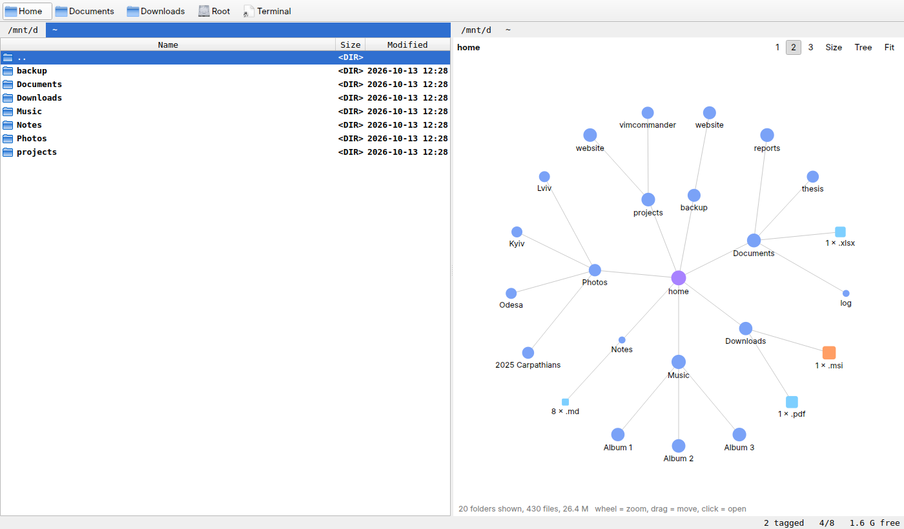

## Contents

- [Features](#features)
- [Screenshots](#screenshots)
- [Installation](#installation)
- [Getting started](#getting-started)
- [Key reference](#key-reference)
- [Commands](#commands)
- **[Finding files and folders](#finding-files-and-folders)**: [Find files](#find-files) · [Result lists](#result-lists) · [Search in files](#search-in-files) · [zoxide](#zoxide) · [Activity calendar](#activity-calendar) · [Which-key and command palette](#which-key-and-command-palette)
- **[Working with files](#working-with-files)**: [Bulk rename](#bulk-rename) · [Global commands](#global-commands) · [Shelf](#shelf) · [Zip files](#zip-files) · [PDF tools](#pdf-tools) · [Folder rules](#folder-rules) · [Freeing space](#freeing-space) · [Trash and undo](#trash-and-undo) · [Jobs and the copy queue](#jobs-and-the-copy-queue) · [Drag and drop](#drag-and-drop) · [Right-click menu](#right-click-menu) · [Launch bar](#launch-bar)
- **[Viewing files](#viewing-files)**: [Quick view](#quick-view) · [CSV plot](#csv-plot) · [Firmware memory map](#firmware-memory-map) · [Folder graph](#folder-graph) · [Music player](#music-player)
- **[Panes and layout](#panes-and-layout)**: [Thumbnail grid](#thumbnail-grid) · [Miller columns](#miller-columns) · [Linked panes](#linked-panes) · [Sessions](#sessions)
- **[Comparing folders and files](#comparing-folders-and-files)**: [Compare and synchronize](#compare-and-synchronize) · [Side-by-side diff](#side-by-side-diff) · [Git](#git)
- **[Terminal](#terminal)**: [Terminal pane](#terminal-pane)
- **[Servers and sharing](#servers-and-sharing)**: [SSH folders](#ssh-folders) · [FTP folders](#ftp-folders) · [Share with a phone](#share-with-a-phone)
- [Configuration](#configuration)
- [Building a standalone app](#building-a-standalone-app)
- [Development](#development)
- [Roadmap](#roadmap)
- [Limitations](#limitations)
- [License](#license)

## Features

**Vim at the core**

- **Modal keys**: normal and visual mode, counts (`5j`, `3yy`, `12G`), sequences (`gg`, `dd`, `Ctrl-w l`), keys that take a character (`ma`, `'a`, `fx`), and a `langmap` so they work in a Ukrainian or Russian layout too.
- **Vim grammar**: operators with motions (`yj`, `d3j`, `yG`, `gUj`), `.` and `@:` to repeat, registers (`"ayy`, `"+p` for the system clipboard), macros (`qa…q`, `@a`), `u` / `Ctrl-r`, marks, `Ctrl-o` / `Ctrl-i`, `''`, ranges (`:'<,'>`, `:%s/a/b/`), `:map` / `:noremap` with `<leader>` and a vimcommanderrc, `q:`, `Ctrl-w` window keys.
- **Vim commands**: `:set` options with relative line numbers, `/` search with smartcase and highlights, `:s/old/new/g` on names, `:g/pattern/cmd`, a quickfix-style [result list](#result-lists) with `]q` / `[q` and `:cdo`, command-line history and editing keys.

**Files**

- **Two panes** with tabs, a drive menu, Total Commander's `F5` / `F6`, and background copies with progress, a [queue](#jobs-and-the-copy-queue) and name-clash choices (overwrite, keep both, skip).
- **Safe by default**: `Del` uses the system trash, and `u` undoes copies, moves, renames, new files and trashing.
- **Renaming**: `cw`, patterns (`:rename photo_{n:3}{ext}`), `:s`, and [bulk rename](#bulk-rename) in your editor.
- **Collect and act**: the [shelf](#shelf), [folder rules](#folder-rules), [zip files](#zip-files) as folders, [PDF tools](#pdf-tools) and checksums.
- **Desktop integration**: [drag and drop](#drag-and-drop) both ways, the Explorer [right-click menu](#right-click-menu), a [launch bar](#launch-bar), live refresh, natural sort (`run2` before `run10`).

**Finding things**

- [Fuzzy file finder](#find-files) (`Ctrl-p`), [search in files](#search-in-files) (`g/`), `:find`, [zoxide](#zoxide) jumps (`:z proj`), recent files and an [activity calendar](#activity-calendar) (`gr`).
- [Which-key and a command palette](#which-key-and-command-palette): pause after `g`, `z` or `Ctrl-w` to see what comes next.

**Seeing what's there**

- [Quick view](#quick-view) (`Ctrl-q`) of text, images, PDFs, Markdown notes, CSV tables or [plots](#csv-plot), Jupyter notebooks, STM32CubeMX projects, [firmware memory maps](#firmware-memory-map) and hex.
- [Folder graphs](#folder-graph): tree, sunburst and treemap of disk usage, a timeline, file types, Obsidian-style note links and code imports.
- [Thumbnail grid](#thumbnail-grid), [Miller columns](#miller-columns), [git](#git) status colors, [free space](#freeing-space) finders (`:reclaim`, `:dupes`).
- A [music player](#music-player) (`gm`) for a folder or the tagged files: one slim row at the bottom, the playlist in a pane on demand.

**Comparing**

- [Compare and synchronize](#compare-and-synchronize) folder trees, `:mirror`, a vimdiff-style [side-by-side diff](#side-by-side-diff), and [linked panes](#linked-panes) for mirror trees.

**Terminals and servers**

- A [terminal panel](#terminal) that follows the pane, and a full [terminal pane](#terminal-pane) (`Ctrl-w t`) with PowerShell, cmd, bash or WSL.
- [SSH](#ssh-folders) and [FTP](#ftp-folders) folders that work like local ones, sshfs mounts, and [sharing with a phone](#share-with-a-phone) by QR code.

**Yours to set up**

- One hand-editable [config file](#configuration) for options, colors and themes, programs, your own keys and `:` commands, and [sessions](#sessions). A [standalone build](#building-a-standalone-app) runs without Python.

## Screenshots

<table>
<tr>
<td width="50%">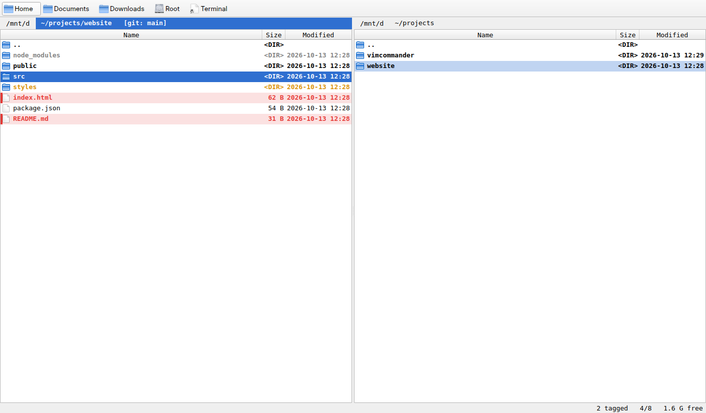<br><sub><b>Two panes</b>: git colors (changed, new, ignored), tagged files in red, the branch in the header</sub></td>
<td width="50%">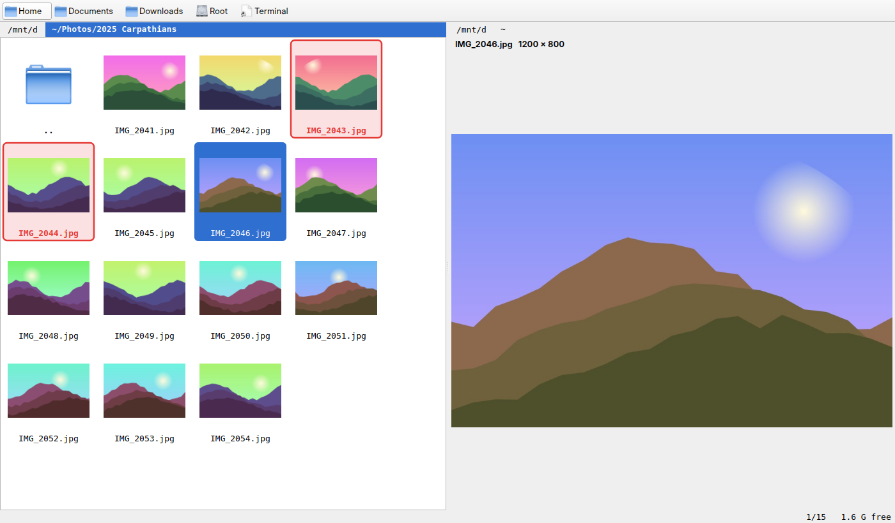<br><sub><b>Thumbnail grid</b> (<code>zi</code>) with tagged photos, and quick view of the photo in the other pane</sub></td>
</tr>
<tr>
<td>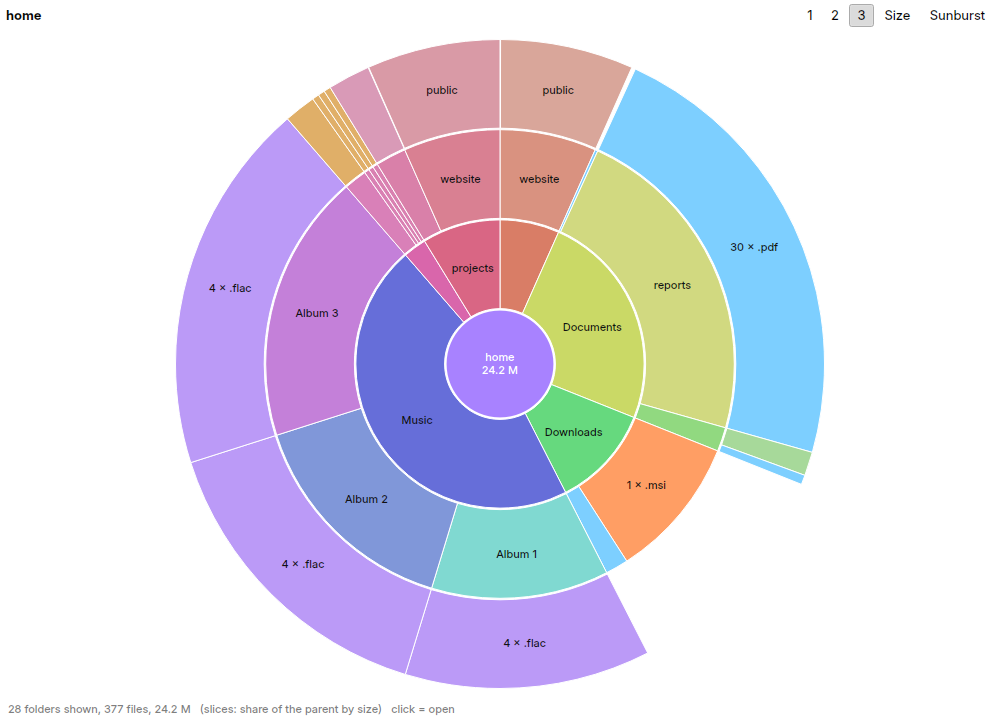<br><sub><b>Sunburst</b> (<code>:graph sunburst</code>): what takes up space, three levels deep</sub></td>
<td>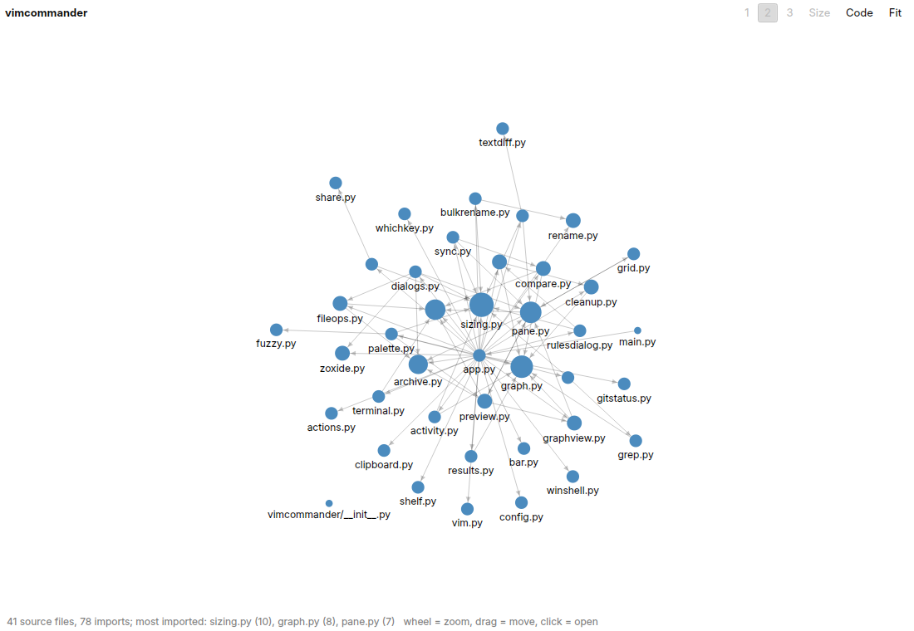<br><sub><b>Code graph</b> (<code>:graph code</code>): imports between source files; the big dots are imported most</sub></td>
</tr>
<tr>
<td>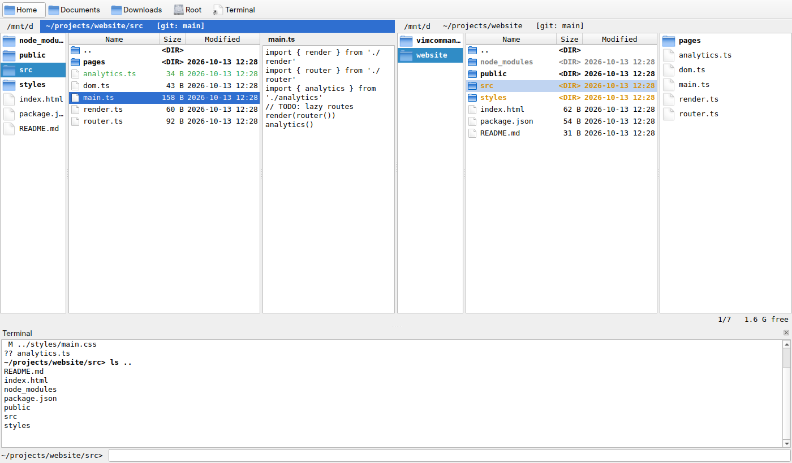<br><sub><b>Miller columns</b> (<code>:set columns</code>) and the <b>terminal panel</b> (<code>Ctrl-`</code>) that follows the pane</sub></td>
<td>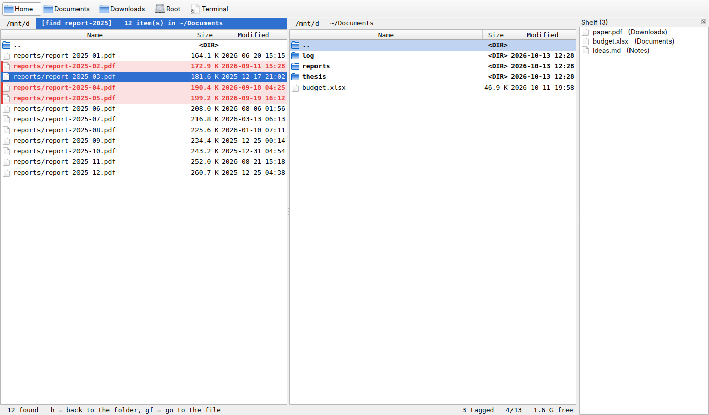<br><sub>A <b>result list</b> from <code>:find</code> (files from many folders, tagged like any others) and the <b>shelf</b></sub></td>
</tr>
<tr>
<td>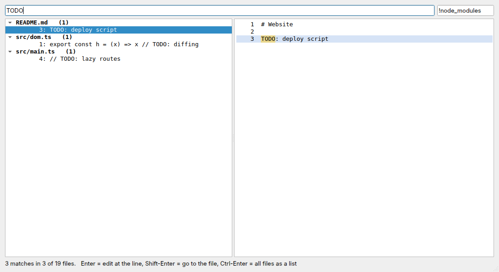<br><sub><b>Search in files</b> (<code>g/</code>) with the matching line in context</sub></td>
<td>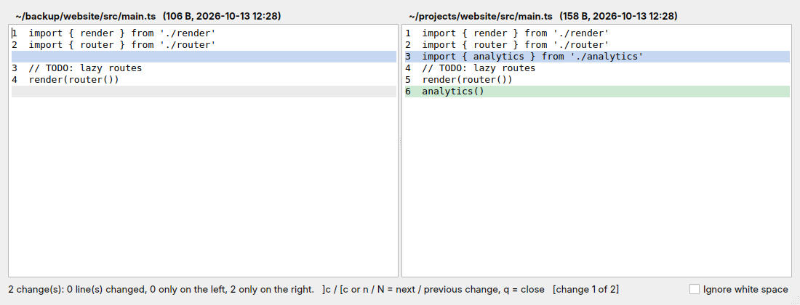<br><sub><b>Side-by-side diff</b> (<code>gd</code>), <code>]c</code> / <code>[c</code> jump between changes</sub></td>
</tr>
<tr>
<td>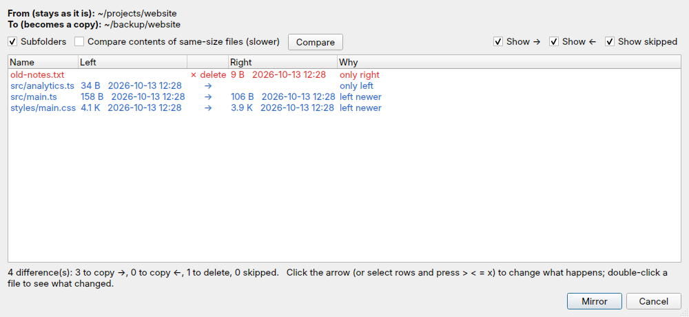<br><sub><b>Mirror</b> (<code>:mirror</code>): a preview of what will be copied and deleted, also to SSH servers</sub></td>
<td>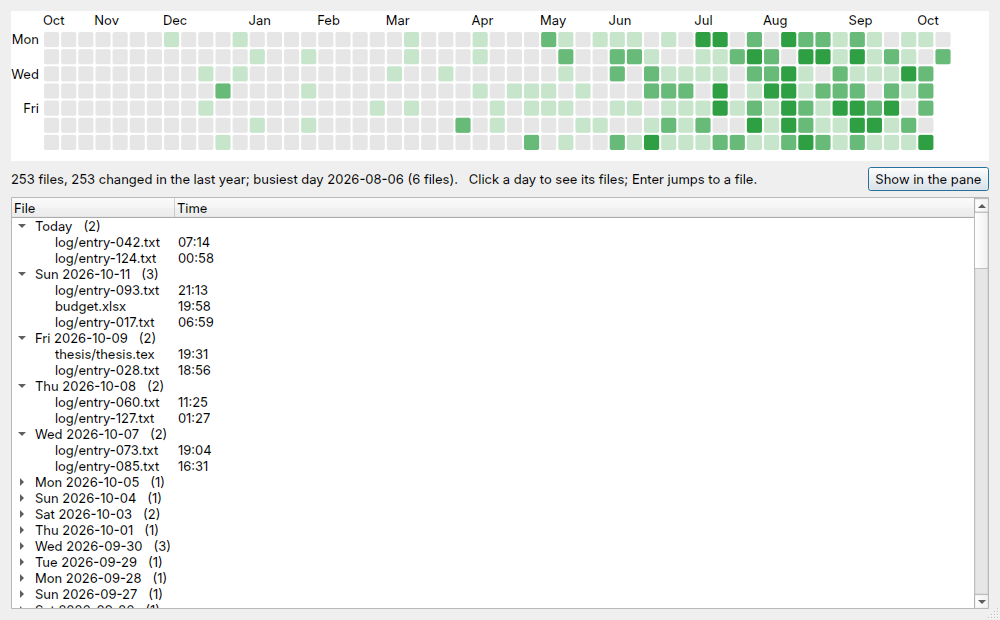<br><sub><b>Activity calendar</b> (<code>gr</code>): when files changed, day by day</sub></td>
</tr>
<tr>
<td>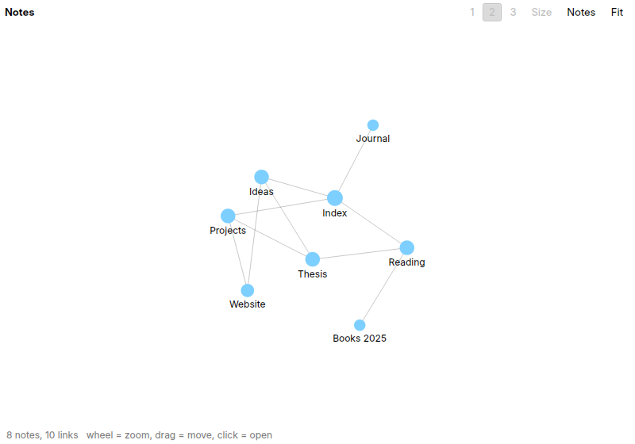<br><sub><b>Notes graph</b> (<code>:graph notes</code>): Markdown notes and their links, like Obsidian</sub></td>
<td></td>
</tr>
</table>

The screenshots show a made-up home folder; `tools/screenshots.py` makes it and renders them headless.

## Installation

**Windows, ready to run**: download `VimCommander-*-windows-x64.zip` from the [latest release](https://github.com/vim4all/VimCommander/releases/latest), unzip it anywhere and start `VimCommander.exe`. No Python needed. The settings are kept in `config.json` next to the exe (portable). Windows SmartScreen may warn the first time, because the exe isn't signed: *More info* → *Run anyway*.

**From source** you need **Python 3.10 or newer**. The dependencies are [PySide6](https://doc.qt.io/qtforpython-6/) (Qt for Python, about 200–300 MB installed), [paramiko](https://www.paramiko.org/) for [SSH folders](#ssh-folders) and [segno](https://segno.readthedocs.io/) for the QR code of [`:share`](#share-with-a-phone). The [music player](#music-player) uses QtMultimedia from `PySide6-Addons` (in requirements.txt; without it everything else still works).

**Linux / macOS**

```bash
git clone https://github.com/vim4all/VimCommander.git
cd VimCommander
python3 -m venv .venv
.venv/bin/pip install -r requirements.txt
.venv/bin/python main.py
```

**Windows** (PowerShell or cmd)

```bat
git clone https://github.com/vim4all/VimCommander.git
cd VimCommander
py -m venv .venv
.venv\Scripts\pip install -r requirements.txt
.venv\Scripts\python main.py
```

To start with specific folders, pass them as arguments:

```bash
python main.py ~/projects ~/Downloads
```

With no arguments, VimCommander reopens the folders you had open last time. On the very first run it opens the current folder on the left and your home folder on the right.

> **WSL users:** the app runs under WSLg, but drag and drop with Windows Explorer only works if you run it with a Windows Python. Use a separate environment for that (for example `.venv-win`), because a Linux `.venv` can't be used from Windows.

## Getting started

If you know vim, most keys do what you expect:

1. Move with `j` / `k`. Open a folder or file with `l` or `Enter`; go up with `h` or `Backspace`.
2. Switch panes with `Tab`.
3. Copy a file: put the cursor on it, press `yy`, switch to the other pane with `Tab`, press `p`.
4. Copy several files: press `v`, extend the range with `j`, then press `F5` to copy them to the other pane.
5. Type `:` for commands, for example `:cd ~/Documents` or `:mkdir new-folder`.
6. Press `F1` at any time for the full key list.

The status bar at the bottom shows the mode (`-- VISUAL --`), keys typed so far (`3y`), what's in the register, how many items are tagged, and the cursor position.

## Key reference

Keys work in the file panes. Unless noted, a count before a key repeats it or applies it to that many items.

### Moving

| Keys | Action |
|---|---|
| `j` / `k` (or arrows) | down / up; `5j` moves 5 rows |
| `gg` / `G` (or `Home` / `End`) | first / last row; `12G` goes to row 12 |
| `Ctrl-d` / `Ctrl-u` | half a page down / up |
| `Ctrl-f` / `Ctrl-b` (or PgDn / PgUp) | a full page down / up |
| `H` / `M` / `L` | top / middle / bottom of the visible rows |
| `{` / `}` | start of the previous / next group: folders, then each run of one extension (sort with `:sort ext` to put them together) |
| `50%` | go to 50% of the list (any count from 1 to 100) |
| `Ctrl-e` / `Ctrl-y` | scroll the list one row down / up without moving the cursor |
| `''` | back to where the cursor was before the last jump (`G`, `gg`, a search, a mark, `:cd`, `:z`…); again to return |
| `fx` / `Fx` | next / previous name starting with `x` |
| `;` / `,` | repeat the last `f` / `F` forward / backward |
| `zz` / `zt` / `zb` | scroll so the cursor is centred / at the top / at the bottom |
| `w` / `b` | next / previous item (the same as `j` / `k` in the list; in the [thumbnail grid](#thumbnail-grid) left and right, while `j` / `k` move a row) |
| `/pattern` / `?pattern` | incremental search forwards / backwards. The pattern is a regular expression (`\d+\.txt$`); with `*` or `?` and no other regex syntax it's a shell pattern (`*.jpg`). Smartcase: case is ignored unless you type a capital. `Enter` on an empty `/` repeats the last search |
| `n` / `N` | next / previous match, in the direction of the last `/` or `?`; `3n` = third match. Wraps around at the ends (`:set nows` to stop there) |
| `*` / `#` | next / previous name with the same extension as the one under the cursor (for a folder: starting with the same word) |
| `=pattern` | filter: show only names matching the pattern, live as you type. The header shows `[filter: …]`. `=` then `Enter` on an empty line clears it; it's also cleared when you leave the folder |

### Folders and panes

| Keys | Action |
|---|---|
| `l`, `Enter`, `→` | open folder, or open file with its default application |
| `h`, `-`, `Backspace`, `←` | parent folder (the cursor lands on the folder you left) |
| `gh`, `~` | home folder |
| `Ctrl-o` / `Ctrl-i` | back / forward in this pane's folder history |
| `Ctrl-^`, `:cd -` | the previous folder of this pane (vim's alternate file) |
| `Tab`, `Ctrl-w w` | switch to the other pane |
| `Ctrl-w h` / `Ctrl-w l` | go to the left / right pane |
| `Ctrl-w o` | only this pane, like vim's `:only`; again (or `Ctrl-w =`, or going to the other pane) shows both |
| `Ctrl-w x`, `Ctrl-w r` | swap the panes: they trade folders, tabs and history, and the cursor goes along |
| `Ctrl-w c`, `Ctrl-w q` | close this pane, so only the other one shows (`:close`) |
| `Ctrl-w v`, `Ctrl-w s` | both panes, the other one in this folder, like vim's split (`:vsplit [PATH]`, `:split`) |
| `Ctrl-w p` | the other pane (vim's previous window) |
| `Ctrl-w =` / `Ctrl-w \|` | panes of equal width / this pane as wide as possible |
| `Ctrl-w <` / `Ctrl-w >` | this pane narrower / wider by 5% (`3 Ctrl-w >` = 15%); the width is saved like a dragged divider |
| `Ctrl-l` | reload both panes |
| `Alt-F1` / `Alt-F2` | drive menu for the left / right pane (also: click the drive button left of the path) |
| `Ctrl-t` | new tab with the same folder |
| `gt` / `gT` | next / previous tab; `3gt` goes to tab 3 |
| `ma` | set mark `a` (any letter) on the file under the cursor |
| `'a` or `` `a `` | jump to mark `a` |

### Views and tools

| Keys | Action |
|---|---|
| `gz` | jump to a folder from zoxide's list (see [zoxide](#zoxide)) |
| `Ctrl-q` | quick view: the other pane previews the item under the cursor (a folder, or `..` for the current folder, shows as a [graph](#folder-graph)); press again to close |
| `zp` | quick view shows CSV files as a [plot](#csv-plot) of their numbers, or as a table again (turns quick view on) |
| `Ctrl-p` | [find files](#find-files) below this folder, by a few letters of their name |
| `g/` | [search inside the files](#search-in-files) below this folder |
| `gf` | in a [result list](#result-lists): open the file's folder with the cursor on it |
| `]q` / `[q` | the next / previous item of the pane's [result list](#result-lists), in its own folder with the cursor on it, like vim's `:cnext`; `3]q` goes three on |
| `gr` | the [activity calendar](#activity-calendar) of this folder |
| `Ctrl-Shift-p` | the [command palette](#which-key-and-command-palette): every action and command, by name |
| `gG` | open the [graph](#folder-graph) of the folder under the cursor (or the current folder) in its own window |
| `za` | show / hide hidden files; `zo` / `zm` show / hide them (as in vifm) |
| `zi` | [thumbnail grid](#thumbnail-grid) / list for this pane |
| ``Ctrl-` `` | show the [terminal](#terminal) and go to it; from the terminal, hide it |
| `Ctrl-w t` | a [terminal pane](#terminal-pane): a real terminal in the other pane, in this folder (again: go into it) |
| `gm` | [play music](#music-player): the tagged items, the folder or `.m3u` under the cursor, or the audio file under the cursor and the rest of its folder |
| `gM` / `]m` / `[m` | pause / resume, next track, previous track (or the start of this one); the keyboard's media keys work too |
| `Ctrl-w m` | the [playlist](#music-player) in the other pane (again: go into it; from it: close it) |
| `g1` … `g9` | press launch bar button 1–9 |

### Selecting

Tagged items are highlighted. File operations act on the tagged items, or on the item under the cursor if nothing is tagged.

| Keys | Action |
|---|---|
| `t`, `Space` | tag / untag the item under the cursor |
| `T` | invert tags |
| `+` | tag by pattern (opens `:select *`) |
| `v`, `V` | visual mode: move to extend the range |
| `o` (in visual mode) | jump to the other end of the range |
| `x` / `c`, `s` / `U`, `u`, `~` (in visual mode) | cut / rename / change the case of the range, like vim |
| `gv` | reselect the last visual range |
| `Esc`, `Ctrl-c`, `Ctrl-[` | leave visual mode and clear tags |
| click / `Ctrl`+click / `Shift`+click | move the cursor / tag or untag one item / tag a range |

### File operations

| Keys | Action |
|---|---|
| `yy`, `Y` | yank (copy) the item; `3yy` yanks 3 items; `y` in visual mode |
| `dd` | cut the item; `d` in visual mode |
| `y` / `d` + motion | yank / cut from the cursor to where the motion goes: `yj`, `d3j`, `yG`, `ygg`, `dk`, `y<C-d>`, `yH`. Counts multiply: `2d3j` cuts 7 rows (the cursor's and 6 more) |
| `.` | repeat the last change: paste, cut, trash, delete, `F5`, `F6`, or a `:rename` / `:s` / `:mkdir` / `:touch`. A count replaces the old one |
| `&` | repeat the last `:s/old/new/` on the tagged items (or the cursor's); `:&` too |
| `@:` | repeat the last `:` command; `3@:` three times |
| `p` | paste the yanked or cut items into this pane's folder |
| `F5` / `F6` | copy / move to the other pane |
| `Alt-F5` | pack the tagged items (or the cursor's) into a zip in the other pane: a dialog for the name, compression level, *move to archive* and *one archive per item*; `u` undoes it |
| `gb` | branch view: every file below this folder in one result list (like Total Commander's Ctrl-B); `h` goes back |
| `Alt-F9` | unpack the tagged zips (or the one under the cursor) into the other pane, optionally each into its own subfolder |
| `Del`, `F8` | move to trash (asks first); `:trash` puts items back |
| `Shift-Del`, `DD` | delete permanently (asks first; can't be undone) |
| `u` / `Ctrl-r` | undo / redo the last copy, move, rename, new folder / file or move to trash; `3u` undoes three. A new change clears what can be redone. The history is kept between runs ([trash and undo](#trash-and-undo)) |
| `"x` before a command | use register `x`: `"ayy` yanks into `a`, `"Ayy` adds to it, `"ap` pastes it, `"a3dd` cuts 3 items into it. `"+` (or `"*`) is the system clipboard: `"+yy` / `"+dd` put files on it for Explorer, Finder or Nautilus to paste, `"+p` pastes files copied or cut there. See also `:set clipboard=unnamedplus` |
| `qa` … `q` | record a macro into `a` (any letter or digit; `qA` adds to it). Every key is recorded, including what you type on the `:` line. The status bar shows `recording @a` |
| `@a`, `@@`, `5@a` | play macro `a`, play the last macro again, play it 5 times |
| `cw`, `F2` | rename |
| `cW` | rename with only the name selected, so the extension stays |
| `I` / `A` | rename with the cursor at the start / end of the name, like vim's insert keys |
| `cc` / `C` | rename, typing a new name / a new name before the extension (`C` keeps `.jpg`) |
| `gUU` / `guu` / `g~~` | the name in UPPER / lower / switched case; with a motion: `gUj`, `gu3j`, `g~G`; `U` / `u` / `~` in visual mode. `.` repeats, `u` undoes |
| `Ctrl-a` / `Ctrl-x` | add / subtract 1 to the last number in the name of the tagged items or the one under the cursor, like vim (`5 Ctrl-a` adds 5): `img_0099.jpg` → `img_0100.jpg`, `v10` → `v9`. Leading zeros keep the width; it stops at 0. Works in visual mode, `.` repeats, `u` undoes |
| `g Ctrl-a` / `g Ctrl-x` | the same, but the first item gets 1, the second 2, the third 3… (vim's `g Ctrl-a`): tag `shot_0.png` ×5 for `shot_1` … `shot_5` |
| `F7` | new folder |
| `F3` / `F4` | view / edit the file(s) with the configured viewer / editor |
| `S` | open a terminal in the current folder |
| `gx` | open with the system's default app, ignoring `open_with`; on a folder (or `..`), open it in Explorer / Finder |
| `Ctrl-g` | show the full path, size, date, permissions (and link target) of the item under the cursor |
| `ZZ`, `ZQ` | close the tab, or quit if it's the last one (like `:q`) |
| `zs` | put the tagged items (or the cursor's) on the [shelf](#shelf); also in visual mode |
| `zS` | show the shelf and go to it; again to hide it |
| `gd` | [diff](#side-by-side-diff) two files side by side: the two tagged files, or the files under the cursors of both panes. If the other pane's cursor isn't on a file and this file is changed in [git](#git), it is compared with its last commit |
| `gs`, `ga` | add up the size of the folder(s) under the cursor or tagged; it's shown in the Size column |
| `gS`, `gA` | add up the sizes of all folders in this pane |
| right-click, `Menu`, `Shift-F10` | context menu (see [Right-click menu](#right-click-menu)) |
| `yf` | copy the full path(s) to the clipboard |
| `yd` | copy the current folder's path to the clipboard |
| `yn` | copy the file name(s) to the clipboard |

## Commands

Type `:` to open the command line. `Enter` runs the command; `Esc` cancels. `Tab` / `Shift-Tab` cycle through completions: command names, and file or folder names for `:cd`, `:mkdir`, `:touch`, `:rename`, `:tabnew`, `:find` and `:bar add`.

As in vim:

- **Commands can be shortened** to any start that is unique: `:bulk` = `:bulkrename`, `:pdfe` = `:pdfextract`. Vim's usual short forms win over other commands that start the same way: `:se` = `:set`, `:sh` = `:shell`, `:e` = `:edit`, `:d` = `:delete`, `:y` = `:yank`, `:pu` = `:put`, `:tabn` = `:tabnext`, `:cn` = `:cnext`. An ambiguous start (`:tab`) lists what it could be.
- **`!` forces**: `:delete!` deletes instead of trashing, `:rename! NAME` replaces an existing NAME (the old one goes to the trash), `:pdfextract! … NAME` replaces NAME, `:sort!` reverses.
- **`:messages`** shows what the status bar said lately, with times.
- **Ranges** go before a command and tag those rows first: `:'<,'>CMD` (typing `:` in visual mode fills it in), `:%CMD` (every item), `:3,8CMD`, `:.,.+4CMD` (`5:` fills in `.,.+4`), `:'a,.CMD`, `:$-2,$CMD`. Rows are the line numbers (`:set nu`); `'a` is mark `a` if it's in this folder. Without a command the rows stay tagged; `:$` and `:'a` alone go there. Examples: `:%s/ /_/g`, `:'<,'>rename {n:2}{ext}`, `:.,+2d`.
- **`q:`** (and `q/`) opens the history in a window: `j` / `k`, `Enter` runs the line, `e` puts it on the command line to edit first.

Vim's command-line keys work on the `:`, `/`, `?` and `=` lines:

| Keys | Action |
|---|---|
| `↑` / `↓`, `Ctrl-p` / `Ctrl-n` | older / newer history entries that start with what you've typed. `:` commands, searches and filters each have their own history (100 entries, kept between runs) |
| `Ctrl-w` / `Ctrl-u` | delete the word / everything before the cursor |
| `Ctrl-b` / `Ctrl-e` | go to the start / end of the line |
| `Ctrl-r Ctrl-f` (or `Ctrl-r Ctrl-w`) / `Ctrl-r Ctrl-p` / `Ctrl-r Ctrl-d` | insert the file name under the cursor / its full path / the current folder |
| `Ctrl-r x` | insert the paths in register `x`, quoted: `Ctrl-r "` the last yank, `Ctrl-r +` the clipboard's files; `Ctrl-r :` the last command, `Ctrl-r /` the last search |
| `Esc`, `Ctrl-c`, `Ctrl-[` | cancel |

### Folders and files

| Command | Action |
|---|---|
| `:cd [PATH]` | change folder (relative to the current one; no path = home) |
| `:mkdir NAME` | create a folder (nested paths allowed) and put the cursor on it |
| `:touch NAME` | create an empty file |
| `:drives` | drive menu for the active pane |
| `:e [FILE]`, `:edit [FILE]` | open FILE (or the file under the cursor) in `programs.editor` |
| `:filter [PATTERN]` | same as `=`; no pattern clears the filter |
| `:sort name\|ext\|size\|time`, `:sort!` | sort this pane; `:sort! size` or `:sort -size` reverses |
| `:delete`, `:d` / `:delete!` | move the tagged items (or the cursor's) to the trash / delete them for good, like `Del` / `Shift-Del` |
| `:trash [WORDS]` | [what is in the trash](#trash-and-undo): put items back where they were (or into this folder), or delete them for good |
| `:yank [x]`, `:y` / `:put [x]`, `:pu` | yank the tagged items (or the cursor's) / paste here; `x` = a register, as with `"xyy` and `"xp` |
| `:normal KEYS`, `:norm` | run KEYS in the pane as if typed, through your maps: `:normal 3jyy`, special keys as `<C-d>`, `<CR>`; `:` … `<CR>` types a command. `:normal!` ignores the maps |
| `:pwd` | show this pane's folder |
| `:select PATTERN` | tag items matching a shell pattern, e.g. `:select *.jpg` |
| `:unselect PATTERN` | untag matching items |
| `:sync` | open this pane's folder in the other pane too |
| `:42` | go to row 42 |

### Renaming

| Command | Action |
|---|---|
| `:rename NAME` | rename the item under the cursor |
| `:rename PATTERN` | rename every tagged item: `{name}` = name without extension, `{ext}` = extension with its dot, `{n}` = 1, 2, 3…, `{n:3}` = 001, 002… Example: `:rename holiday_{n:3}{ext}`. `cw` with tagged items starts this for you |
| `:g/PATTERN/[CMD]`, `:g!/…`, `:v/…` | [global command](#global-commands): tag the items whose names match (`:g!` and `:v`: don't match), then run CMD on them |
| `:s/OLD/NEW/[g][i]` | replace a regular expression in the names of the tagged items (or the item under the cursor). `g` = every match, `i` = ignore case, `&` = the match, `\1` = a group. Example: `:s/ /_/g` |
| `:bulkrename`, `:br` | [rename](#bulk-rename) the tagged items (or all items) as text, in a dialog or your editor |

### Finding and result lists

| Command | Action |
|---|---|
| `:find PATTERN [CONDITIONS]` | search the names in this folder and all subfolders, `*.log` or plain text to match part of a name; the pane shows the matches as a [result list](#result-lists) (`Esc` stops a long search). Conditions: `size>1M`, `size<500k` (units `k`, `m`, `g`; files only), `newer:7d`, `older:2w` (changed within / before: `h`, `d`, `w`, `y`), `type:f` / `type:d` (files / folders). The pattern may be left out: `:find size>500M older:1y` |
| `:grep [TEXT]` | [search inside the files](#search-in-files) below this folder (same as `g/`) |
| `:results`, `:res` | show the pane's last [result list](#result-lists) again |
| `:branch` | branch view, same as `gb` |
| `:cdo !COMMAND`, `:cdo COMMAND` | for each item of the [result list](#result-lists) (the tagged ones, or all): run a shell command in the item's folder with `%f` = the item (`:cdo !dos2unix %f`), or a `:` command with the cursor on the item (`:cdo pdfextract 1`) |
| `:cnext [N]`, `:cn` / `:cprevious [N]`, `:cp` | same as `]q` / `[q` |
| `:copen` / `:cclose` | show the pane's result list (same as `:results`) / leave it |
| `:clist` | the items of the result list, numbered; `>` marks the one `]q` went to last |
| `:colder [N]` / `:cnewer [N]` | the result list before / after this one: each pane keeps its last 10, like vim's quickfix lists |
| `:recent`, `:recent [changed] DAYS`, `:recent clear` | files you opened (Enter, `:e`, F3/F4…), newest first, as a result list; or the files changed below this folder in the last DAYS days (default 7), newest first |
| `:files`, `:palette`, `:activity` | same as `Ctrl-p`, `Ctrl-Shift-p`, `gr` |
| `:z KEYWORDS` | jump to the best zoxide match, like `z` in a shell; `:z` alone = home. `Tab` cycles through the matches |
| `:zi [KEYWORDS]` | pick from zoxide's list, same as `gz` |

### Comparing and git

| Command | Action |
|---|---|
| `:diffthis [FILE]` | [diff](#side-by-side-diff) two files: tagged, under both cursors (`gd`), or the cursor's file and FILE |
| `:git`, `:git changed`, `:git diff` | [git](#git): branch and counts / every changed file as a result list / the file under the cursor next to its last commit |
| `:linkpanes [on\|off]`, `:link` | [link the panes](#linked-panes): both go into the same subfolders |
| `:mirror` | make the other pane's folder a copy of this one: copy what is new or changed, delete what only the other side has, after a [preview](#compare-and-synchronize) |
| `:compare`, `:diff` | [tag the differences](#compare-and-synchronize) between the two panes' folders |
| `:synchronize` | [compare the panes' folder trees](#compare-and-synchronize) and copy what differs |

### Archives, PDFs, checksums and space

| Command | Action |
|---|---|
| `:hash [ALGO]` | write a checksum file (`md5`, `sha1`, `sha256` default, `sha512`) for the tagged items, folders included, in the `sha256sum` / Total Commander format; `:hash check`, or `:hash` with the cursor on a `.sha256` etc., verifies one and lists files that differ or are missing |
| `:zip [NAME]` | pack the tagged items (or the cursor's) into `NAME.zip` in this folder; `u` removes it again |
| `:pdfextract PAGES [NAME]` | copy pages of the PDF under the cursor into a new PDF next to it: `3`, `2-5`, `1,4,7-` (7 to the end), `-3` (1 to 3), `9-7` (backwards), `$` = the last page; they come out in the order written. No NAME = `<name> pPAGES.pdf`; with several PDFs tagged, each gets its own. `u` removes the result |
| `:pdfmerge [NAME]` | join the tagged PDFs into `NAME.pdf` in this folder, in the order the pane shows them (so `0_…`, `1_…` prefixes or a sort set the order); no NAME = `<first file> merged.pdf`. If any PDF can't be read nothing is saved; `u` removes the result |
| `:reclaim [SIZE] [DAYS]` | [caches and big old files](#freeing-space) below this folder, biggest first (default: files over 100M unchanged for 180 days) |
| `:dupes [MINSIZE]`, `:dupes tag [old]` | [duplicate files](#freeing-space) as a result list; in it, tag all but the newest (or oldest) copy of each set |
| `:rules` | preview and apply the [folder rules](#folder-rules) |

### Views and panels

| Command | Action |
|---|---|
| `:obsidian` | open the note (or folder) under the cursor in Obsidian |
| `:shelf [add\|copy\|move\|zip [NAME]\|list\|clear]` | the [shelf](#shelf); no argument shows / hides it |
| `:play [PATH]` | the [music player](#music-player): play the files under the cursor (same as `gm`), or a folder, file or `.m3u` |
| `:play pause\|next [N]\|prev\|stop\|off\|list` | control it; `off` stops and hides the bar, `list` shows the playlist (`Ctrl-w m`) |
| `:play shuffle [on\|off]`, `:play repeat [all\|one\|off]`, `:play volume N\|+N\|-N`, `:play speed RATE`, `:play seek S\|+S\|-S`, `:play save NAME` | shuffle, repeat, volume (0–100), speed (`1.5`, `150%`, `+0.25`, `-0.25`, `+` / `-` = the next step; 0.25–4), seek in seconds; `save` writes the playlist as `NAME.m3u8` here |
| `:grid [on\|off\|SIZE]` | [thumbnail grid](#thumbnail-grid) for this pane (same as `zi`), or the thumbnail size in pixels |
| `:jobs [pause\|resume\|cancel]` | show / hide the [jobs panel](#jobs-and-the-copy-queue), or pause, resume or cancel every job |
| `:hex [on\|off]` | quick view shows every file as a hex dump (binary files always do); no argument toggles |
| `:graph` | open the graph window (same as `gG`) |
| `:graph 1\|2\|3`, `size\|count`, `tree\|sunburst\|treemap\|timeline\|types\|notes\|code`, `on\|off` | graph depth, what node size shows, the mode, graph in quick view on or off; several at once (`:graph 3 count`). Saved |
| `:bar` | show / hide the launch bar |
| `:bar add [PATH]` | add a folder or program to the launch bar (default: current folder) |

### Servers and sharing

| Command | Action |
|---|---|
| `:mount`, `:umount` | in an SSH folder: [mount it with sshfs](#terminal-pane) in the terminal pane's Linux (WSL on Windows) at `~/mnt/HOST` / unmount it |
| `:ftp [user@]host[:port][/path]`, `:ftp close` | open a folder on an [FTP server](#ftp-folders) in this pane (`ftps://host` = FTP over TLS); close all connections |
| `:ssh [user@]host[:path]`, `:ssh close` | open a folder on an [SSH server](#ssh-folders) in this pane (`Tab` completes hosts from `~/.ssh/config`); close all connections |
| `:share`, `:share stop` | [share](#share-with-a-phone) the tagged items (or the cursor's) with a phone by QR code; on `..` only receive files |

### Shells and terminals

| Command | Action |
|---|---|
| `:terminal [COMMAND]`, `:term` | show the [terminal](#terminal); with a command, run it there |
| `:vterm [SHELL]`, `:vterm off` | a [terminal pane](#terminal-pane) in the other pane: `wsl`, `wsl:NAME`, `pwsh`, `cmd`, `bash` or a command line; `off` closes it |
| `:!COMMAND` | run a shell command in the current folder; `%d` `%o` `%f` `%s` are filled in (quoted), `%%` is a literal `%`. A `%` on its own is vim's: the file's name, `%:p` its full path, `%:h` its folder, `%:t` the name, `%:r` without the extension, `%:e` the extension (`:!tar xf % -C %:r`) |
| `:shell` | open a terminal in the current folder |

### Tabs, sessions, marks, registers and undo

| Command | Action |
|---|---|
| `:mksession NAME`, `:session [NAME]`, `:delsession NAME` | save, open (or list) and delete [sessions](#sessions) |
| `:tabnew [PATH]`, `:tabclose` | open a tab (in PATH or the current folder) / close the current one |
| `:tabnext [N]`, `:tabn` / `:tabprevious`, `:tabp` | the next tab (or tab N) / the previous one, like `gt` / `gT` |
| `:tabfirst` / `:tablast` / `:tabonly` | the first / last tab / close the pane's other tabs |
| `:undo`, `:redo` | same as `u` / `Ctrl-r` |
| `:undolist` | list what can be undone and redone, with when each change was made |
| `:reg`, `:registers`, `:di`, `:display` | list the registers, the clipboard's files and the macros |
| `:tabs` | list both panes' tabs |
| `:tabmove [N]` | move the tab after tab N (`0` = first, nothing = last, `+1` / `-1` = one step) |
| `:marks` | list marks |
| `:delmarks [LETTERS]` | delete the given marks, or all marks |

### Options, help and quitting

| Command | Action |
|---|---|
| `:q`, `:quit`, `:x`, `:wq` | close the current tab; quit if it's the pane's only tab |
| `:messages`, `:mes` | the status bar's recent messages, with times |
| `:qa`, `:qall`, `:quitall`, `:wqa`, `:xa` | quit |
| `:set OPTION` | vim options, see below: `:set rnu`, `:set nonu`, `:set nu!` (toggle), `:set ic?` (show), several at once; `:set` alone lists them. Changes are saved |
| `:noh`, `:nohlsearch` | clear the search highlight until the next search |
| `:config` | open the config file in the editor; changes apply when you save it |
| `:help [TOPIC]`, `:h` | show the key reference; with a topic, only the lines that mention it (`:h Ctrl-w`) |
| `:map`, `:nmap`, `:vmap`, `:noremap`, `:nnoremap`, `:vnoremap`, … | [map keys to keys](#maps-and-vimcommanderrc); alone, list the maps |
| `:unmap`, `:nunmap`, `:vunmap` / `:mapclear` | remove a map / all of them |
| `:let mapleader = ","` | the key `<leader>` stands for in maps made after it (default `\`) |
| `:source [FILE]`, `:so` | run the `:` commands in FILE; no FILE = the `vimcommanderrc` |
| `:command NAME REPLACEMENT`, `:command` / `:delcommand NAME` | a `:` command for this session (arguments go after the replacement), list them / remove one |
| `:only` / `:close` / `:vsplit [PATH]` | only this pane / only the other / both (like `Ctrl-w o` / `c` / `v`) |

### Options for :set

| Option (short) | Default | Meaning |
|---|---|---|
| `number` (`nu`) | off | line numbers. Row 1 is `..`, so `12G` goes to the row numbered 12 |
| `relativenumber` (`rnu`) | off | numbers relative to the cursor, for counts like `5j` or `d3j`. With `number` too, the cursor's row shows its own number |
| `ignorecase` (`ic`) | on | searches and filters ignore case |
| `smartcase` (`scs`) | on | …unless the pattern has a capital letter |
| `hlsearch` (`hls`) | on | highlight the names that match the last search |
| `wrapscan` (`ws`) | on | `n` / `N` continue from the other end |
| `hidden` | off | show hidden files (same as `za`) |
| `columns` | off | [Miller columns](#miller-columns): parent folder, list and preview in each pane |
| `git` | on | [git](#git) status colors and the branch in the header |
| `natural` | on | numbers in names sort by value: `run2` before `run10`. Off: plain text order |
| `clipboard` (`cb`) | `""` | `unnamedplus` (or `unnamed`): plain `y`, `d` and `p` use the system clipboard, as in vim. `:set clipboard=` turns it off |

These switch views for this session only (they aren't saved), so `:set plot!`, `:set grid?` and `:set noqv` work like any option:

| Option (short) | Same as |
|---|---|
| `hex` | `:hex`: quick view shows every file in hex |
| `plot` | `zp`: CSV files show as a [plot](#csv-plot) |
| `grid` | `zi`: the [thumbnail grid](#thumbnail-grid) in this pane |
| `quickview` (`qv`) | `Ctrl-q`: [quick view](#quick-view) |
| `linkpanes` (`lp`) | `:linkpanes`: [linked panes](#linked-panes) |
| `bar` | `:bar`: the [launch bar](#launch-bar) |

`:set` saves them to the config file, where they are the top-level `number`, `relativenumber`, `ignorecase`, `smartcase`, `hlsearch`, `wrapscan`, `clipboard`, `show_hidden`, `columns`, `git` and `natural_sort` options.

## Finding files and folders

### Find files

`Ctrl-p` (or `:files`) lists every file and folder below the current folder and filters them as you type, fzf style: the letters must appear in order (`vcapp` finds `vimcommander/app.py`), and matches at the start of a word, of a file name, or in a row score higher. Folders you often visit (from [zoxide](#zoxide), if installed) rank higher. The right side previews the selected item, like quick view.

| Key | Action |
|---|---|
| `↑` `↓`, `Ctrl-j` `Ctrl-k`, `Ctrl-n` `Ctrl-p` | move |
| `Enter` | go there: the pane opens the folder with the cursor on the file |
| `Shift-Enter` | open the file with its app |
| `Ctrl-t` | go there in a new tab |
| `Ctrl-Enter` | show all the matches as a [result list](#result-lists) in the pane |
| `Esc` | close |

Hidden files are included when they're shown in the pane (`za`). `.git`, `node_modules`, `__pycache__` and similar folders are skipped.

### Result lists

A pane can show a list of files from many folders instead of one folder: the results of `:find`, of [`:grep`](#search-in-files) (`Ctrl-Enter`), of the [file finder](#find-files) (`Ctrl-Enter`), of the [activity calendar](#activity-calendar) (*Show in the pane*) and of the [shelf](#shelf) (`:shelf list`). The path header shows `[find *.log]   12 item(s) in ~/projects`, and the names show their path relative to that folder (`src/app/main.log`). `:find` fills the list while it searches; `Esc` stops it.

Everything that works on files works here: tag (`t`, `v`, `:select`), `yy` / `dd`, `F5` / `F6` to the other pane, `Del`, `cw` and `:rename` / `:s` / `:bulkrename` (each file keeps its folder), `F3` / `F4`, quick view, `/` search and the `=` filter, `:sort`, and `u`. Trashed or moved files drop out of the list; renamed files stay in it.

| Keys | Action |
|---|---|
| `h`, `-`, `Backspace`, `..` | leave the list: back to the folder the search ran in |
| `gf` | open the folder of the file under the cursor, with the cursor on it |
| `l`, `Enter` | open the file, or go into the folder (which leaves the list) |
| `:results` | show the list again after leaving it |
| `]q` / `[q`, `:cn` / `:cp` | go to the next / previous item in its own folder, with the cursor on it; in the list, it goes on from the item under the cursor. So you can work through `:grep` matches where the files are |
| `:cdo !COMMAND` | run a shell command for each item (the tagged ones, or all), one after another, in the item's folder: `%f` is the item, `%d` its folder, `%o` the other pane's folder. `Esc` stops; the status bar says how many failed, with the first error. The output isn't shown: use the [terminal](#terminal) for commands that print |
| `:cdo COMMAND` | run a `:` command once for each item, with the cursor on it, e.g. `:cdo pdfextract 1` (the first page of each PDF, next to it) or `:cdo rename {name}_v2{ext}`. `:g` instead tags the matches and runs a command once |

A result list isn't a folder, so you can't paste or create files in it (`p`, `F7`, `:touch`), nor copy or drop files into it; `h` first. A tab can hold a result list; they aren't kept between runs.

### Search in files

`g/` (or `:grep TEXT`) searches inside the files below the current folder as you type. The left side lists each file with its matching lines; the right side shows the selected line in context, with the matches highlighted.

- The text is a regular expression (or plain text if it isn't a valid one), with vim's `ignorecase` / `smartcase`: `todo` matches `TODO`, `Todo` matches only `Todo`.
- The box on the right limits the files: shell patterns separated by spaces, `!` to leave out, e.g. `*.py *.md !test_*`. It is remembered for the next search.
- Binary files, files over 20 MB, and `.git`, `node_modules`, `__pycache__` and similar folders are skipped; hidden files are searched when they're shown (`za`). The search stops at 10,000 matches.

| Key | Action |
|---|---|
| `↑` `↓`, `Ctrl-j` `Ctrl-k`, `PgUp` `PgDn` | move through files and lines |
| `Enter` | open the file in the editor at that line (set `programs.editor_line`, see [Programs](#programs); otherwise the editor opens the file at the top) |
| `Shift-Enter` | go to the file in the pane |
| `Ctrl-Enter` | show every matching file as a [result list](#result-lists) |
| `Esc` | close |

### zoxide

[zoxide](https://github.com/ajeetdsouza/zoxide) remembers the folders you use and jumps to them by a few letters of their names. If it is installed, VimCommander records every folder a pane opens (folders inside zip files are skipped), using the same database as your shell's `z`.

| To… | Do this |
|---|---|
| jump to the best match | `:z proj vim`: the keywords must appear in that order, and the last one in the folder's own name (zoxide's rule) |
| choose from a list | `gz` or `:zi [KEYWORDS]`: type to filter, `↑`/`↓` or `Ctrl-j`/`Ctrl-k` to move, `Enter` jumps, `Shift-Enter` opens a new tab |
| go to a path | `:z PATH` also accepts a real folder path |

Install zoxide with `winget install ajeetdsouza.zoxide` (Windows), `brew install zoxide` (macOS) or your Linux package manager. VimCommander finds it on `PATH`; otherwise set `programs.zoxide` to its full path. On Windows with WSL, Windows and WSL each have their own zoxide database.

### Activity calendar

`gr` (or `:activity`) shows when files below the current folder changed:

- **A calendar of the last year**, one square per day, darker for more changed files (GitHub style). Hover a day for its count.
- **The most recently changed files**, grouped by day (Today, Yesterday, Mon 2026-10-05…).
- **Click a day** to list only its files (older days are searched on demand); click it again to go back. `Enter` or double-click on a file jumps to it.
- **Show in the pane** (`Ctrl-Enter`) puts the listed files in the pane as a [result list](#result-lists), so you can tag, copy or trash, say, everything you changed yesterday.

The scan skips `.git`, `node_modules` and similar folders, and stops after 400,000 files or 20 seconds.

### Which-key and command palette

**Which-key.** Type the first key of a sequence and wait half a second: a panel above the status bar lists every key that can follow, with what it does. It works after `g`, `z`, `y`, `d`, `c`, `Z`, `Ctrl-w`, after `"` (it lists the registers and what's in them), `m` and `'` (your marks and where they point), `q` and `@` (your macros), and after any key you map yourself. Set `which_key_delay` in the config to change the pause (milliseconds), or to `0` to turn the panel off.

**Command palette** (`Ctrl-Shift-p` or `:palette`). Every action and `:` command in one searchable list, with its keys, e.g. type `hid` for "show / hide hidden files   za". `Enter` runs it; a command that needs an argument (`:cd PATH`) opens the `:` line for you to finish it. Your own commands from the config are listed too.

## Working with files

### Bulk rename

`:bulkrename` (or `:br`) shows the tagged items, or all items if none are tagged, as numbered lines:

```text
1	holiday.jpg
2	IMG_2041.jpg
3	notes.txt
```

Change the names after the numbers, then press **Apply**: everything is renamed at once, swaps and case changes included, and `u` undoes it. **Delete a line** to move that item to the trash (it asks first). Lines starting with `#` are ignored.

**Open in editor** opens the same text in your editor (`programs.editor`), so you can use vim, `:%s`, macros and multiple cursors. Each time you save there, the dialog's text follows; press Apply when you're done. (For a terminal editor such as nvim, set `programs.editor` to a command that opens a terminal, e.g. `wt.exe nvim`.)

### Global commands

Vim's `:g` works on the file names of the current pane: `:g/PATTERN/CMD` tags every item whose name matches PATTERN, then runs CMD on the tagged items. PATTERN works like `/` search: a regular expression, or a shell pattern if it only has `*` and `?`, with smartcase. `:g!/PATTERN/CMD` and `:v/PATTERN/CMD` take the items that **don't** match. Any punctuation can be the delimiter (`:g#a/b#d`), and an empty pattern reuses the last search.

| CMD | Does |
|---|---|
| *(nothing)* | only tag the items: `:g/\.jpe?g$/` |
| `d` | move them to the trash (asks first): `:g/\.log$/d` |
| `d!` | delete them permanently (asks first) |
| `y`, `y x` | yank them, into register `x` if given; then `p` in the other folder |
| `normal KEYS` | press KEYS, e.g. `:g/^IMG_/normal <F5>` copies them to the other pane |
| any `:` command | run it on the tagged items: `:g/ /s/ /_/g`, `:g/\.md$/zip notes`, `:v/\.py$/shelf add` |

### Shelf

The shelf is a panel on the right where you collect files from different folders, then do something with all of them at once. Unlike a register it is visible, it keeps its items until you remove them, and it is saved between runs.

| To… | Do this |
|---|---|
| put files on it | `zs` (the tagged items or the cursor's; also in visual mode), *Put on the shelf* in the right-click menu, `:shelf add`, or drag files onto it |
| show / hide it, go to it | `zS` or `:shelf`; its close button hides it |
| copy / move them into the pane's folder | `:shelf copy` / `:shelf move` (or right-click the shelf) |
| zip them | `:shelf zip [NAME]` makes `NAME.zip` in the pane's folder |
| work on them in a pane | `:shelf list` shows them as a [result list](#result-lists) |
| drag them somewhere | drag from the shelf into a pane (copy; `Shift` = move) or into another app |
| take items off | in the shelf, `d` or `Del` (the files themselves stay); `:shelf clear` empties it |

In the shelf, `j` / `k` move, `Enter` goes to the file in the pane, and `Esc` goes back to the pane. The commands act on the items selected in the shelf, or on all of them. Moved and renamed files stay on the shelf under their new path; files that are trashed or deleted drop off.

### Zip files

`Enter` (or `l`) on a `.zip` (also `.jar` and `.whl`) opens it like a folder; `h` leaves it. Inside you can browse, preview with `Ctrl-q`, open files (they are extracted to a temporary folder first), and copy files and folders out with `F5`, `yy` / `p` or a drag. You can delete items with `Delete` / `F8` / `Shift-Delete` (permanently: the zip is rewritten without them, and there is no undo). Otherwise zip files are read-only: you can't move or rename items in them or copy files into them. If you set a program for `.zip` in `programs.open_with`, `Enter` runs that program instead.

### PDF tools

| Command | Does |
|---|---|
| `:pdfmerge [NAME]` | joins the tagged PDFs, in the order the pane shows them, into `NAME.pdf` here. Name them `0_…`, `1_…` or sort the pane to set the order. Nothing is saved if any PDF can't be read |
| `:pdfextract PAGES [NAME]` | copies pages of the PDF under the cursor (or of each tagged one) into a new PDF next to it, named `<name> pPAGES.pdf` unless NAME is given |

Page lists: `3`, `2-5`, `1,4,7-` (7 to the end), `-3` (1 to 3), `9-7` (backwards), `$` (the last page); pages come out in the order written, so `:pdfextract 3,1,2` also reorders. `u` removes the new PDF. In a [result list](#result-lists), `:cdo pdfextract 1` takes the first page of every PDF.

### Folder rules

Folder rules tidy folders such as Downloads, like Hazel on macOS. Write them in the config's `rules` list:

```json
"rules": [
  {"name": "old PDFs", "folder": "~/Downloads", "match": "*.pdf *.djvu",
   "older_than_days": 7, "action": "move", "to": "~/Documents/PDF"},
  {"name": "installers", "folder": "~/Downloads", "match": "*.msi *.exe",
   "older_than_days": 30, "action": "trash"},
  {"folder": "~/Desktop", "match": "Screenshot*.png", "action": "move", "to": "~/Pictures/Screenshots"}
]
```

| Key | Meaning |
|---|---|
| `folder` | where to look (only the files directly in it, unless `"subfolders": true`) |
| `match` | shell patterns separated by spaces, or a list; case doesn't matter. Default: every file |
| `older_than_days`, `larger_than` | optional: last changed at least this many days ago / bigger than `"10M"` |
| `action`, `to` | `"move"` or `"copy"` to the `to` folder (made if missing), or `"trash"` |
| `name` | optional, shown in the preview |

**`:rules`** never acts straight away: it shows every file the rules would move, copy or trash. Untick what to leave alone (`Space` toggles the selected rows) and press **Apply**. Each file is handled by the first rule that matches it, hidden files are left alone, and `u` undoes the moves.

### Freeing space

**`:reclaim`** looks below the current folder for space you can safely get back and shows it as a [result list](#result-lists), biggest first, each with a note saying what it is:

- **Rebuildable folders**: `node_modules`, `__pycache__`, `.venv` / `venv`, `.tox`, `.pytest_cache`, `.mypy_cache`, `.gradle`, `.next`, `.dart_tool`, `Pods`, `DerivedData`, `.pio` (PlatformIO), `.ipynb_checkpoints`, `.vs` and similar. `build`, `dist`, `target`, `obj`, `coverage`, `Debug`, `Release` and Keil's `Objects` / `Listings` count only next to a project file (`package.json`, `pyproject.toml`, `Cargo.toml`, `CMakeLists.txt`, `*.csproj`, `*.vcxproj`, Eclipse / STM32CubeIDE's `.cproject`, Atmel Studio's `*.cproj`, Keil's `*.uvprojx`, IAR's `*.ewp`, `platformio.ini`…), so your own "build" folder of photos isn't listed.
- **Ansys Electronics Desktop**: `X.aedtresults` next to `X.aedt` (the solutions; solving again rebuilds them, which can take long), and `X.aedt.lock` files older than a day, which AEDT leaves behind when it crashes. Delete a lock only while AEDT is closed.
- **Big files that haven't changed for a long time**: over 100 MB and unchanged for 180 days by default; `:reclaim 500M 365` changes both.

Tag what you don't need and press `Del` (it goes to the trash, so `u` brings it back).

**`:dupes`** finds files with the same content below the current folder: same size, then the same first 64 KB, then the same full hash. The result list shows each set together (`[set 3: 4 copies of 12.5 M]`), the sets that waste the most space first. `:dupes 1M` skips files under 1 MB. In the list, **`:dupes tag`** tags every copy except the newest of each set (`:dupes tag old`: except the oldest), ready for `Del`.

### Trash and undo

`Del` moves items to the system trash, and `u` brings them back, as it undoes copies, moves, renames and new files. **The undo history is kept between runs** (the last 50 changes, in `undo.json` next to the config), so you can still undo yesterday's cleanup after a restart; `:undolist` shows each change with its time. Set `"persistent_undo": false` to forget it on quit.

**`:trash`** shows everything in the trash, the most recently trashed first, with where each item was, when it was trashed and its size; type to filter by name or folder (`:trash report` starts filtered).

| Key | Action |
|---|---|
| `Enter` | put the selected items back where they were (an item whose place is taken again is skipped with a message) |
| `Shift-Enter` | put them into the active pane's folder instead (`name (1).ext` when the name is taken) |
| `Shift-Del` | delete them from the trash for good (asks first) |
| `↑` / `↓`, `Ctrl-j` / `Ctrl-k`, `Shift-↑` / `Shift-↓`, `Ctrl-A` | move, extend the selection, select all |

Restoring is a change like any other, so `u` sends the items back to the trash. It reads the Windows Recycle Bin of every drive and the freedesktop.org trash on Linux (the home trash and the `.Trash-1000` folders of other drives). On macOS the trash doesn't record where an item came from, so only `Shift-Enter` works there.

### Jobs and the copy queue

Copies, moves, `:synchronize` / `:mirror` and `:zip` run one at a time: one started while another is running waits in a queue, so two big copies to the same disk don't slow each other down. The first job shows the usual progress window, with *Pause* and *Background* (hide the window, keep going in the panel). Queued jobs show in the **jobs panel**, which opens by itself when something is queued and closes when the queue is empty; `:jobs` shows or hides it any time.

Each row in the panel shows the job's progress, with *Pause* / *Resume*, *Cancel* (a waiting job is just removed) and *Next* (run this waiting job next). A paused waiting job is skipped until you resume it. `:jobs pause`, `:jobs resume` and `:jobs cancel` act on all jobs at once. Pausing stops between two chunks of a file; nothing is lost. Trash, delete and undo don't wait in the queue. To run every job at once as before, set `"queue_jobs": false` in the config.

### Drag and drop

- **Drag from a pane** to another app, to the other pane, or onto a folder in either pane.
- **Drop from another app** onto a pane to copy the files into that pane's folder, or onto a folder row to copy them into that folder.
- A plain drop **copies**. Hold **Shift** while dropping to **move**.
- Dropping files onto a pane that already shows their folder does nothing.

### Right-click menu

Right-click an item, or press the `Menu` key or `Shift-F10`. If you right-click a tagged item, the menu acts on all tagged items. If you right-click any other item, the tags are cleared and the menu acts on that item. Right-click empty space or `..` for a menu for the folder itself.

- **Windows**: the same menu Explorer shows, including *Open with*, *Send to*, *Properties* and the items other programs add (7-Zip, Git, VS Code, antivirus…). VimCommander's own items are at the bottom: Edit with the configured editor, Quick view, Copy path, Folder size, Put on the shelf, Terminal here. *Rename* and *Delete* from this menu use VimCommander's rename and trash, so `u` can undo them.
  - Hold **Shift** while right-clicking to get Explorer's extended items, such as *Copy as path*.
  - Hold **Ctrl** while right-clicking to get VimCommander's own menu instead.
- **Linux and macOS**, and inside zip files: VimCommander's own menu with Open, View, Edit, Copy, Cut, Paste, Rename, Trash, Delete, Copy path, Put on the shelf, Folder size, Terminal here, and so on.

### Launch bar

The bar above the panes holds buttons for folders and programs you use often.

| To… | Do this |
|---|---|
| open a folder in the active pane | click its button, or press `g1`…`g9` |
| run a program | click its button, or press `g1`…`g9` |
| add a button | drop a folder or program on empty bar space, run `:bar add [PATH]`, or right-click → *Add current folder* / *Add button…* |
| open files with a program | drag the files onto the program's button |
| copy files into a favourite folder | drag them onto the folder's button (hold `Shift` to move) |
| edit, remove or reorder | right-click a button → *Edit…*, *Remove*, *Move left/right* |
| hide the text labels | right-click → *Show labels* |

A button has a **name**, a **path or command** (a folder, a program path, or a command found on `PATH`, such as `code`), optional **arguments** and an optional **icon** file. If the path is a document rather than a program, it opens with its default application.

These placeholders are filled in when the program starts:

| Placeholder | Replaced with |
|---|---|
| `%d` | the active pane's folder |
| `%o` | the other pane's folder |
| `%f` | the file under the cursor |
| `%s` | the tagged files (or the file under the cursor), or the dropped files |

Some examples:

| Name | Path | Arguments |
|---|---|---|
| VS Code here | `code` | `%d` |
| Edit with VS Code | `code` | `%s` |
| Windows Terminal | `wt.exe` | `-d %d` |
| Compare panes | `meld` | `%d %o` |

Programs start in the active pane's folder. On the first run the bar is filled with Home, Desktop, Documents, Downloads (if they exist), the root folder, and a terminal for your platform.

## Viewing files

### Quick view

`Ctrl-q` turns the other pane into a preview of the item under the cursor; it follows the cursor as you move, and `Ctrl-q` again closes it.

| Item | Shows |
|---|---|
| folder, or `..` for the current one | a [folder graph](#folder-graph) (`:graph off`: a short summary) |
| text file | its first 256 KB |
| image | the picture, scaled to fit |
| PDF | the first pages, rendered |
| Markdown note | rendered; Obsidian `[[links]]` and embedded images work, click a link to go to that note. Also understands [md2doc](https://github.com/vim4all/DCR_MD_to_PDF) documents: front matter as a title block, colored callouts (`> **WARNING** …`, `> [!note]`), tables with shaded cells (`<!--bg:best-->`), footnotes, task lists, simple `$math$`, and mermaid / matplotlib blocks as figures: the PNGs md2doc made next to the note, or mermaid drawn by [mermaid-cli](https://github.com/mermaid-js/mermaid-cli) (`mmdc` on the PATH) into the cache |
| CSV / TSV | a table with the row and column count; hover a column header for min, max, mean or distinct values. `zp` shows a [plot](#csv-plot) instead |
| Jupyter notebook (`.ipynb`) | its cells, outputs and plots: code shaded, outputs indented below |
| STM32CubeMX project (`.ioc`) | the chip, clocks, a pin table with labels and modes, the peripheral settings you changed, DMA and interrupts |
| LTspice result (`.raw`) | its traces as a [plot](#csv-plot); an operating point as a table |
| linker `.map`, `.elf` | the [firmware memory map](#firmware-memory-map) |
| binary file | a hex dump (`:hex` shows every file that way) |

Files inside zips show too; on SSH and FTP servers, text and images.

### CSV plot

`zp` makes quick view show a CSV file as a plot instead of a table (`zp` again: the table). Each numeric column gets a strip of its own, one above the other, all over the same x axis: a rising column named like time (`Time`, `t`, `x`, `sec`, `Second`) or else a rising first column; otherwise the row number. With more columns than fit, the strips scroll.

- **Names and units** come from the header row. Rows above the numbers that aren't a header, such as a scope's settings (Siglent, Rigol) or a title line, are skipped, and a second header row is taken as the units (`CH1 [Volt]`). Columns of text are left out; empty cells are gaps in the line.
- **Mouse**: the value of each column under the mouse shows next to its name, and the x value under the axis. Drag across the plot to zoom into that part, right-click to zoom back out, double-click to see it all.
- **Statistics**: each strip shows min, max, mean and RMS of the part in view.
- **Any column as the x axis**: click a column's name to plot the others against it; `x: NAME` at the bottom left shows which, and a click on it goes back to time (or the row number). A column that rises is drawn as lines; any other as a **scatter** of points, e.g. an optimization's designs: efficiency, power and voltage against frequency. A scatter draws up to 40,000 points per strip; the statistics count every row in view.
- **Big files** are read in the background, up to 16 million numbers (a 700,000-row, 6-column file takes about two seconds). Long columns are drawn as one min–max bar per pixel, so short spikes still show.

Semicolon-separated files with decimal commas work; the file is read as UTF-8. CSV files inside zips can be plotted, files on SSH and FTP servers show as tables only.

**LTspice results** (`.raw`) always show as this plot, without `zp`: every trace with its unit (`V(out) [V]`, `I(L1) [A]`) over time. Transient runs in LTspice's binary or text format work, with float or double values and the "fastaccess" layout; an AC analysis shows each trace's magnitude in dB over frequency; an operating point (`.op.raw`) shows as a table of values. A stepped run is plotted over the row number. Another program's `.raw` file (a camera image) shows in hex.

### Firmware memory map

Quick view (`Ctrl-q`) of a linker map file or a firmware image shows what fills the microcontroller's memory:

- **GNU ld `.map`** files (STM32CubeIDE, Atmel Studio, ESP-IDF, avr-gcc, PlatformIO…): the memory regions from the map's *Memory Configuration* (FLASH, RAM, CCMRAM…), each with its sections (`.text`, `.rodata`, `.data`, `.bss`, heap and stack), object files and functions. `.data` counts twice, as in the linker's own summary: in RAM, and its initial values in Flash.
- **Keil MDK `.map`** files: the load and execution regions, and Code, RO, RW and ZI data per object file.
- **`.elf` / `.axf`** images: Flash and RAM from the sections, with the functions and variables of the symbol table. If a `.map` with the same name is next to it, that is shown instead (it knows the object files).

At the top, a bar per region shows how full it is (green, yellow over 70%, red over 90%); click one to see what fills it. Below, a treemap: sections with their object files inside; click a box to zoom into it (then into its functions), right-click or click the path line to go back. Hover a box for its exact size and share. A `.map` that isn't a linker map (a JavaScript source map, a game level) is shown as text.

### Folder graph

Quick view (`Ctrl-q`) on a folder, or on `..` for the current folder, shows it as a graph in the style of Obsidian's graph view. The mode button (*Tree*, *Sunburst*, *Treemap*, *Timeline*, *Types*, *Notes*, *Code*), or `:graph MODE`, switches between seven views. `gG` or `:graph` opens the same graph in a big window of its own.

**Tree mode** (the default) shows the shape of a folder at a glance:

- The folder is in the middle, with its subfolders around it 1, 2 or 3 levels deep (buttons `1` `2` `3` at the top, or `:graph 2`).
- Files are grouped by extension into one square per folder and extension ("142 × .jpg"), so big folders stay readable. When a folder has many items, the smallest are folded into one "+N more" dot.
- Node size shows the total size on disk (button *Size*), or the number of files (button *Files*). Sizes of the outer folders are added up in the background; until that's done, the total ends in `+`.
- Colors show the kind of content: folders blue, images yellow, video red, audio purple, code green, documents cyan, archives orange, programs light grey, design files (Ansys, KiCad, CAD) teal, build output (`.o`, `.elf`, `.hex`) tan.

**Sunburst mode** (`:graph sunburst`) answers "what's taking up space?": the folder is the circle in the middle, and each ring further out is one level deeper. A slice is as wide as its share of its parent, by size (or by number of files with *Files*), so big folders are big slices. Folders are colored by their angle (like Filelight), file groups by kind. Hover a slice for its size; click it to open it.

**Treemap mode** (`:graph treemap`) shows the same as the sunburst as nested boxes, like WinDirStat: each box is as big as its size (or number of files), folders hold their subfolders' boxes with the name and size in a strip at the top, and folders under the same top-level folder share a color. Small things deep down stay visible, which the sunburst hides. Depth `1` `2` `3` sets how far down it goes.

**Timeline mode** (`:graph timeline`) answers "when did I work on what?": one row per subfolder, newest activity on top, with a bar from its oldest to its newest file and a cell for each month in which files changed (darker = more files). The *All* row at the top is the whole folder. Dead projects, old backups and what you're busy with now stand out at once. Hover a row for its dates.

**Types mode** (`:graph types`) shows what each subfolder is made of: one bar per subfolder, as long as its size (or number of files with *Files*), split by kind (code, design files such as Ansys, KiCad and CAD, documents, images, video, audio, archives, programs, build output such as `.o` / `.elf` / `.hex`, other) with the share in percent. The *All* row is the whole folder.

Timeline and types read every file below the folder, up to 8 seconds; a folder not finished by then gets a `+` after its size.

**Notes mode** (`:graph notes`) shows the Markdown files below the folder and the links between them, as in Obsidian: `[[wikilinks]]` (with `#heading` and `|alias`, matched by file name in any subfolder) and `[text](other.md)` links. A note's dot grows with its number of links; notes without links float alone. The layout settles like Obsidian's, and the `.obsidian` folder is skipped, so an Obsidian vault works as is.

**Code mode** (`:graph code`) is a map of a software project: each source file below the folder is a dot, and an arrow goes from a file to each file it imports. A file's dot grows with the number of files that import it, so the core modules stand out as hubs; the status line names the three most imported. Colors show the language. It understands:

- **Python**: `import a.b`, `from a.b import c`, `from . import x`, `from ..pkg import y` (submodules and packages in the folder).
- **JavaScript / TypeScript**: relative `import … from './x'`, `export … from`, `import('./x')` and `require('./x')`, with or without the extension, and `./dir` for `./dir/index.ts`.
- **C / C++**: `#include "x.h"` (next to the file, or a header of that name elsewhere in the project).
- **Go**: imports of packages in the project (matched by the end of the import path).
- **Rust**: `mod x;` (`x.rs` or `x/mod.rs`).

Imports of libraries outside the folder are left out, as are `build`, `dist`, `target`, `vendor`, `node_modules` and virtualenv folders. Up to 800 files are shown.

| To… | Do this |
|---|---|
| zoom / move | mouse wheel (zooms around the pointer) / drag; *Fit* fits it to the view |
| see what a node is | hover: it and its neighbours light up, the rest fades, and a tooltip shows the path, size and number of files |
| open a folder | click it: the active pane opens it, and the graph re-centers on it |
| see a group of files | click a square like "142 × .jpg": the pane opens that folder filtered to `*.jpg` (`=` then `Enter` clears the filter) |
| go to a note or source file / open it | click it to put the cursor on it; double-click to open it |

Up to 400 nodes are shown (300 notes); scanning runs in the background and stops when you move on. Folders inside zip files show the usual summary instead. The options are saved in the config's `graph` section; `:graph off` goes back to the plain folder summary in quick view.

### Music player

`gm` plays music from the pane: the tagged items, else the folder or `.m3u` playlist under the cursor (with its subfolders, so `CD1`, `CD2` follow in order), else, on an audio file, that file and the rest of its folder; on `..`, the current folder. In a [result list](#result-lists) it plays the list's audio files. Tracks play in name order, `2` before `10`. It plays mp3, FLAC, Ogg, Opus, m4a / AAC, WAV, WMA, AIFF and more.

The player is one slim row at the bottom of the window, shown when music starts: previous / play-pause / next, the track (click it for the playlist), a seek bar (click to jump), the time, volume, the speed (`1×`: click to choose 0.5× to 3×, or turn the mouse wheel over it; voices keep their pitch), shuffle `⇄`, repeat `↻` (the list, `↻1` this track, `→` stop at the end), the playlist `≡`, and `✕` to stop and hide it. It never takes the keyboard from the panes. `gM` pauses and resumes, `]m` / `[m` go to the next / previous track (`[m` first goes back to the start of the track), and the keyboard's media keys do the same while the window is active.

`Ctrl-w m` shows the **playlist in the other pane**, like the [terminal pane](#terminal-pane). In it:

| Keys | Action |
|---|---|
| `j` `k` `gg` `G` `Ctrl-d` `Ctrl-u` | move |
| `Enter` or `l` | play this track |
| `Space` | pause / resume |
| `n` / `N` | next / previous track |
| `←` / `→` | seek 5 seconds back / on |
| `+` / `-` | louder / quieter |
| `}` / `{` / `0` | faster / slower / normal speed |
| `s` / `r` | shuffle on / off, next repeat mode |
| `d`, `x` or `Del` | take the track off the list (the file stays) |
| `o` | show the file in the file pane |
| `Esc`, `h`, `Tab` or `Ctrl-w h/l/w` | back to the files (the playlist stays; `Tab` goes back into it) |
| `q` | close the playlist (the music goes on) |

Drop files or folders on the playlist to add them. `:play save NAME` writes it as `NAME.m3u8` in the pane's folder, with relative paths, so it works when the folder moves; `gm` on it plays it again. Volume, speed, shuffle and repeat are saved in the config's `player`.

## Panes and layout

### Thumbnail grid

`zi` (or `:grid`) shows the active pane as a grid of tiles instead of a list: images as thumbnails (turned by their EXIF orientation), folders as their first picture, other files as big icons. `zi` again goes back. Each pane remembers its choice between runs.

Everything works as in the list: the cursor and tags are the same (tagged tiles get a red frame), and `yy`, `dd`, `F5`, `Del`, `cw`, `Ctrl-q`, visual mode, search, the filter, drag and drop and the right-click menu all apply. In the grid `j` / `k` move a whole row down / up and `w` / `b` one tile right / left; `h` and `l` still go to the parent and open. **Ctrl+mouse wheel** (or `:grid 200`) changes the thumbnail size, from 48 to 320 pixels; it is saved as `thumbnail_size`.

Thumbnails are made in the background, scaled down while the image is decoded so big photos load quickly, and the last 3000 are kept in memory. Files inside zip files show icons.

### Miller columns

`:set columns` shows each pane as three columns, like ranger or macOS Finder's column view: the parent folder (with the current folder highlighted) on the left, the list in the middle, and on the right what's under the cursor: a folder's items, or a preview of a file (text or image). The columns follow as you move. `:set nocolumns` goes back to the plain list (`:set columns!` toggles); the choice is saved.

### Linked panes

`:linkpanes` (or `:link`) ties the two panes together for comparing mirror trees, such as a project and its backup copy, or two versions of a folder:

- When you open a subfolder in the active pane, the other pane opens the same subfolder on its side. If it doesn't exist there, the status bar says so.
- When you move the cursor, the other pane's cursor goes to the item with the same name.
- Items that only one side has are colored purple.

The path headers show `[linked]`. `:linkpanes` again unlinks them. (`:compare` and `:synchronize` work as before for copying the differences.)

### Sessions

A session is a saved workspace: both panes' tabs (with the folder and file each was on), any [result lists](#result-lists) in them, the active pane, the [shelf](#shelf), and [linked panes](#linked-panes).

- `:mksession NAME` (or `:mks NAME`) saves the current one; saving to an existing name replaces it.
- `:session NAME` opens it; `:session` alone lists the names, and `Tab` completes them.
- `:delsession NAME` deletes one.

Sessions are kept in the config file's `sessions` section.

## Comparing folders and files

### Compare and synchronize

**`:compare`** compares the two panes' folders (not their subfolders) by name, size and date, and tags in each pane the items that are newer there or only there. Then `F5` copies the tagged items across.

**`:synchronize`** compares the two folder trees, subfolders included, like Total Commander's "Synchronize dirs". A list shows every difference with a proposed direction:

| Shown | Meaning | Proposed |
|---|---|---|
| only left / only right | the item exists on one side | copy it to the other side |
| left newer / right newer | same name, different date | copy the newer over the older |
| differ, same time | same date but different size | nothing (you choose) |

Click the arrow in a row to cycle → / ← / ✗ delete / nothing, or select rows and press `>`, `<`, `=` or `x` (delete, for an item that only one side has). Double-click a file that is on both sides to see what changed in a [side-by-side diff](#side-by-side-diff). The checkboxes hide rows by direction, include subfolders or not, and **compare the contents** of same-size files with different dates (slower; equal ones are then left out). **`:mirror`** opens the same list set up to make the *other* pane's folder an exact copy of the *active* one: everything new or changed is copied across, and items only the other side has are marked **✗ delete**. Check the list, change what you like, then press **Mirror**. Deleted local items go to the trash; on an [SSH server](#ssh-folders) they are deleted. Both work between a local folder and a server folder, for deploying a site or backing up a project.

**Synchronize** copies everything, with the progress dialog; newly created files can be undone with `u`. Files are the same when size and date match within 2 seconds (FAT drives store times in 2-second steps).

### Side-by-side diff

`gd` (or `:diffthis`) shows two text files side by side, like vimdiff: the two tagged files, or else the files under the cursors of the two panes (left pane on the left). `:diffthis FILE` compares the file under the cursor with FILE. Files inside zip files work too.

- Lines are lined up: changed lines are yellow with the changed part darker, lines only on the left red, lines only on the right green, with an empty row opposite. The current change is blue.
- Both sides scroll together. *Ignore white space* compares lines without their spacing.
- Binary files (and files over 8 MB) are only reported as the same or different.

| Keys | Action |
|---|---|
| `]c` / `[c`, `n` / `N` | next / previous change |
| `j` / `k`, `Ctrl-d` / `Ctrl-u`, `Ctrl-f` / `Ctrl-b` | scroll a line, half a page, a page |
| `gg` / `G` | top / bottom |
| `Tab` | the other side (to select and copy text) |
| `q`, `Esc` | close |

### Git

When the folder is in a git repository (and `git` is installed), file names are colored by their status, and the path header shows the branch, with `↑2 ↓1` when it is ahead of or behind its upstream:

| Color | Meaning |
|---|---|
| orange | changed since the last commit; a folder is orange when something inside it changed |
| green | new: not committed yet (untracked or just added) |
| pink | a merge conflict |
| grey | ignored by `.gitignore` |

The status is updated whenever the folder changes, in the background. Hovering a colored name shows its status.

- **`:git`** shows the branch and how many files are changed, new or in conflict.
- **`:git changed`** shows every changed and new file of the whole repository as a [result list](#result-lists), so you can view, copy or trash them.
- **`:git diff`** (or `gd` when the other pane's cursor isn't on a file) shows the file under the cursor next to its last committed version, in the [diff window](#side-by-side-diff).

`:set nogit` turns it off. Set `programs.git` if git isn't on your `PATH`; the colors are in the config's `colors` section.

## Terminal

``Ctrl-` `` (or `:terminal`) opens a terminal panel under the panes, starting in the active pane's folder. Type a command and press `Enter`; the output appears above.

- **It follows the pane**: when the active pane opens another folder (or you switch panes), the terminal `cd`s there, unless a command is still running.
- **The pane follows it**: `cd somewhere` in the terminal opens that folder in the active pane.
- `↑` / `↓` = command history, `Ctrl-C` = stop the running command, `Ctrl-L` (or `cls` / `clear`) = clear, `Esc` = back to the pane (the terminal stays open), ``Ctrl-` `` from the terminal hides it. While a command runs, what you type goes to it, so you can answer questions like `Continue? [y/n]`.
- The shell is **PowerShell** on Windows (`pwsh` if installed) and your `$SHELL` (or bash) elsewhere; set `programs.shell` to use another, e.g. `"cmd.exe"` or `"C:\\Program Files\\Git\\bin\\bash.exe"`.

It is a shell reading commands line by line, not a full terminal emulator: commands, scripts, git, compilers and their output work, but programs that draw a full-screen interface (vim, htop, less) don't. For those, use the [terminal pane](#terminal-pane), or `S` for a terminal window. Stopping a command with `Ctrl-C` on Windows restarts the shell (in the same folder). `programs.shell` may also be `"wsl"` or `"wsl:Ubuntu"`: bash in WSL, with the folders translated both ways.

### Terminal pane

`Ctrl-w t` (or `:vterm`) turns the **other pane** into a real terminal, started in this pane's folder. Full-screen programs work there: vim, htop, less, mc, git's pager, `ssh`, password prompts, colors and the mouse wheel.

- **Which shell**: `:vterm wsl` (your default WSL distro), `:vterm wsl:Ubuntu`, `:vterm pwsh`, `:vterm cmd`, `:vterm bash`, or any command line. Without one it uses `vterm.shell` from the config, else `programs.shell`, else PowerShell on Windows and your `$SHELL` elsewhere.
- **It follows the file pane both ways**: when the file pane opens a folder, the shell `cd`s there (only while it waits at its prompt with nothing typed, so it never types into a running program); a `cd` in the shell opens that folder in the file pane. For WSL the folders are translated: `D:\Pr\Ws` is `/mnt/d/Pr/Ws`, and Linux folders such as `~/proj` open as `\\wsl.localhost\Ubuntu\home\you\proj`. Set `"vterm": {"follow": false}` to keep them apart; the terminal pane's own folder still follows the shell, so `F5` copies into the shell's folder.
- **Keys**: everything goes to the program, except `Ctrl-w` followed by `h` `j` `k` `l` `w` or `p`, which goes back to the files (`Ctrl-w .` sends a `Ctrl-w` to the program; `Ctrl-w` followed by any other key sends both). `Tab` or `Ctrl-w w` from the files goes back into the terminal.
- **Scrolling and copying**: `Shift-PgUp` / `Shift-PgDn` or the mouse wheel scroll back (in less or vim the wheel scrolls their text). Drag to select, double-click selects a word; `Ctrl-Shift-C` copies, `Ctrl-Shift-V` or `Shift-Insert` pastes, right-click copies the selection or, without one, pastes.
- `exit` (or `:vterm off`) closes it and the pane shows its files again.

The folder following uses the OSC 7 escape sequence: bash gets it through `PROMPT_COMMAND`, PowerShell and cmd through their prompt. Other shells (zsh, fish) work but don't follow.

**WSL in the drive menu**: on Windows, the drive menu (`Alt-F1` / `Alt-F2`) lists your WSL distros; one opens `\\wsl.localhost\NAME\home`, so you can copy between Windows and Linux with `F5`.

**`:mount`** in an [SSH folder](#ssh-folders) mounts it in the terminal pane's Linux (WSL on Windows) with `sshfs`, at `~/mnt/HOST`, and `cd`s there, so Linux tools see the server's files as local ones. It types the command in the terminal pane (opening one if needed), so you can answer a password prompt. `:umount` unmounts it. It needs `sshfs` in Linux (`sudo apt install sshfs`).

## Servers and sharing

### SSH folders

`:ssh user@host:/path` opens a folder on an SSH server in the active pane; `:ssh host` opens your home folder there, and `:ssh host:projects` a folder in it. `host` can be an alias from `~/.ssh/config` (with its `HostName`, `User`, `Port`, `IdentityFile` and `ProxyCommand`); `Tab` completes them. The header shows `user@host:/path` and the drive button `ssh host`.

Logging in works like `ssh`: your SSH agent and your keys (`~/.ssh/id_ed25519`, `id_rsa`…) are tried first, then you are asked for the password (or a key's passphrase). The first time you connect to a server, its key fingerprint is shown; when you trust it, it is saved in `~/.ssh/known_hosts`. The connection stays open for both panes until you quit or run `:ssh close`.

In an SSH folder:

| To… | Do this |
|---|---|
| move around | as usual: `l`, `h`, `gg`, `/`, `=`, marks, tabs, the [thumbnail grid](#thumbnail-grid) (icons only) and quick view (`Ctrl-q` shows text, Markdown and images) |
| copy or move between this computer and the server | `F5` / `F6` with the other pane, `yy` / `dd` + `p`, or drag files from the other pane or from Explorer onto it, with the progress dialog; modification times are kept |
| edit a file | `F4` or `:e`: it is downloaded, opened in your editor, and **uploaded each time you save** it |
| open a file | `Enter`: a copy is downloaded and opened with its app |
| rename, new folder, new file | `cw`, `:rename`, `:s`, `:bulkrename`, `F7`, `:touch` |
| delete | `Del` asks and deletes for good (a server has no trash) |
| get a shell there | ``Ctrl-` `` (or `S`): the [terminal](#terminal) runs your shell on the server, in this folder, and follows the pane |
| keep a folder in step | `:mirror` from a local pane to a server pane (or the other way), or `:synchronize` |
| come back quickly | `:bar add` puts the folder on the launch bar; marks (`ma`) and sessions work too |

Local-only tools (`:find`, `:grep`, `Ctrl-p`, the graph, `gr`, `:dupes`, `:reclaim`, `:share`, the shelf) say so in the status bar. Remote folders don't refresh by themselves: `Ctrl-l` reloads, and after your own file operations they reload anyway. `u` undoes what happened on this computer (a download), not changes on the server.

### FTP folders

`:ftp host` opens an FTP server's folder in the active pane, logged in as `anonymous`; `:ftp user@host/pub/files` logs in as `user`, in that folder, and `:ftp user@host:2121` uses another port. For FTP over TLS (explicit FTPS), write the URL: `:ftp ftps://user@host/path`. The password is taken from `~/.netrc` (`machine host login user password …`) when it's there, else you are asked; it is kept only while the app runs. Paths are shown as `ftp://user@host/path`, and the drive button says `ftp host`.

Everything in the [SSH folders](#ssh-folders) table works the same, except the shell: FTP has none, so the terminal stays on this computer. Each copy or move opens its own login next to the one used for listing, so the server must allow two connections per user. Modification times are kept when the server understands `MFMT`. Listing uses `MLSD` and falls back to the classic `LIST` (Unix and Windows / IIS styles). `:ftp close` (or `:ssh close`) logs out of every server.

### Share with a phone

`:share` makes the tagged items (or the one under the cursor) downloadable on your local network and shows a **QR code**. Scan it with the phone's camera (on the same Wi-Fi): a page lists the files, tap one to download it, and a folder downloads as a zip. On `..`, `:share` only receives files.

The same page has **Choose files…**, which sends files from the phone (photos, documents) into the pane's folder, with a progress bar each. A name that already exists gets ` (1)` added.

- Only someone with the link can see anything: every address contains a random code, new for each share.
- Sharing stops after 15 minutes, when you close the window or press `Esc`, or with `:share stop`.
- If the phone can't open the page, pick another address in the window (computers with VPN, WSL or Hyper-V adapters have several). On Windows, allow VimCommander through the firewall when asked; set a fixed `share.port` so you only need to allow it once.

The `share` section of the config sets `port` (`0` = any free one), `minutes` and `upload` (`false` = the phone can only download).

## Configuration

All settings live in one JSON file, `config.json`. Run `:config` to open it in your editor. When you save it, the app reloads it at once. Only the window size and font wait for a restart. On every start the app adds any missing options with their defaults, so the file always lists everything you can set.

Where the file is:

| Situation | Location |
|---|---|
| `VIMCOMMANDER_CONFIG` is set | that path |
| standalone build (see below) | `config.json` next to the executable, so the folder is portable |
| Linux | `~/.config/VimCommander/config.json` |
| Windows | `%LOCALAPPDATA%\VimCommander\config.json` |
| macOS | `~/Library/Preferences/VimCommander/config.json` |

If the file has a syntax error, the app tells you and uses defaults. It saves nothing until you fix the file, so your edits are never overwritten.

### Options

```json
{
  "window": {"width": 1100, "height": 700, "maximized": false},
  "font": {"family": "", "size": 0},
  "monospace": {"enabled": true, "family": "", "size": 0},
  "theme": "",
  "show_hidden": false,
  "natural_sort": true,
  "git": true,
  "columns": false,
  "rules": [],
  "thumbnail_size": 128,
  "share": {"port": 0, "minutes": 15, "upload": true},
  "player": {"volume": 70, "shuffle": false, "repeat": "all", "speed": 1.0},
  "number": false, "relativenumber": false,
  "ignorecase": true, "smartcase": true, "hlsearch": true, "wrapscan": true,
  "clipboard": "",
  "sort": "name",
  "date_format": "%Y-%m-%d %H:%M",
  "confirm_trash": true,
  "persistent_undo": true,
  "queue_jobs": true,
  "restore_panes": true,
  "history_limit": 100,
  "programs": {
    "editor": "notepad.exe",
    "editor_line": "",
    "viewer": "",
    "terminal": "",
    "open_with": {},
    "zoxide": "",
    "git": "",
    "shell": ""
  },
  "commands": {},
  "keys": {"normal": {}, "visual": {}}
}
```

| Option | Meaning |
|---|---|
| `window` | starting size in pixels, or start maximized (applies at start) |
| `font` | font family and point size for the whole window; `""` / `0` = system default (applies at start) |
| `theme` | `""` = the system look, `"catppuccin-mocha"` = [Catppuccin Mocha](https://catppuccin.com) for the whole window; see [Colors](#colors) |
| `colors` | colors of the cursor, tagged items, search matches and more; see [Colors](#colors) |
| `graph` | the [folder graph](#folder-graph): `enabled` (in quick view), `depth` (1–3), `size_by` (`"size"` or `"count"`), `mode` (`"tree"`, `"sunburst"`, `"treemap"`, `"timeline"`, `"types"`, `"notes"` or `"code"`), `max_nodes` (50–2000) |
| `which_key_delay` | milliseconds after a prefix key before the [which-key](#which-key-and-command-palette) panel shows; `0` = never |
| `timeoutlen` | like vim's: milliseconds a key waits when a map starts with it (a map `,x` next to the built-in `,`), before it runs on its own |
| `vimrc` | the [vimcommanderrc](#maps-and-vimcommanderrc) file run at start, relative to the config file's folder |
| `vterm` | the [terminal pane](#terminal-pane): `shell` (`""` = `programs.shell`, else the system's; or `"wsl"`, `"wsl:Ubuntu"`, `"pwsh"`, `"cmd"`, `"bash"`, a command line) and `follow` (the shell and the file pane `cd` along with each other) |
| `langmap` | like vim's `langmap`: keys typed in another keyboard layout act as the keys at the same place on a US keyboard, so you don't have to switch layouts for `j`, `gg`, `dd`, `:` or `Ctrl-d`. `"cyrillic"` (default) covers Ukrainian and Russian (`о` = `j`, `пп` = `gg`, `Ж` = `:`); `""` turns it off. Vim's format works too: comma-separated `FROM;TO` lists or pairs, e.g. `"cyrillic,õ[ü]"`. Only non-ASCII characters can be mapped, so the US layout is never affected. It applies to normal and visual mode keys (counts, marks and registers included), not to the `:` / `/` line, and not to the character after `f` / `F`, so `fс` still finds a name starting with Cyrillic `с` |
| `monospace` | monospace font for the file lists, path headers, command line, status bar and quick view. `family` `""` picks the first installed of Cascadia Mono, Consolas, JetBrains Mono, SF Mono, Menlo, DejaVu Sans Mono, …; `size` `0` = same size as the window font; `"enabled": false` uses the window font instead |
| `show_hidden` | show hidden files at start (`za` toggles) |
| `natural_sort` | numbers in names sort by value, `run2` before `run10` (`:set natural`) |
| `git` | [git](#git) status colors and branch (`:set git`) |
| `columns` | [Miller columns](#miller-columns) (`:set columns`) |
| `player` | the [music player](#music-player): `volume` (0–100), `shuffle`, `repeat` (`"all"`, `"one"` or `"off"`), `speed` (0.25–4, `1.0` = normal); the player saves them when you change them |
| `rules` | the [folder rules](#folder-rules) for `:rules` |
| `thumbnail_size` | size of the [thumbnails](#thumbnail-grid) in pixels, 48–320 (Ctrl+wheel in the grid changes it) |
| `share` | [sharing with a phone](#share-with-a-phone): `port` (`0` = any free port), `minutes` until it stops, `upload` (may the phone send files) |
| `number`, `relativenumber`, `ignorecase`, `smartcase`, `hlsearch`, `wrapscan` | vim options, see [Options for :set](#options-for-set) |
| `sort` | `name`, `ext`, `size` or `time`; prefix `-` to reverse, e.g. `"-time"` |
| `date_format` | format of the *Modified* column, in Python [`strftime`](https://docs.python.org/3/library/datetime.html#format-codes) codes |
| `confirm_trash` | ask before moving to trash |
| `persistent_undo` | keep what `u` / `Ctrl-r` can undo and redo between runs, in `undo.json` next to the config; `false` = only while the app runs |
| `queue_jobs` | run copies, moves, syncs and zips one after another ([copy queue](#jobs-and-the-copy-queue)); `false` = all at once |
| `restore_panes` | reopen the last folders and tabs; `false` = current folder and home |
| `pane_ratio` | the left pane's share of the width, `0.1`–`0.9` (default `0.5`). Dragging the divider between the panes saves it, and it is kept when the window is resized |
| `history_limit` | how many folders `Ctrl-o` remembers per pane |
| `programs.editor` | program for `F4` and `:config`; `""` = the file's default application. Default: `notepad.exe` on Windows, `open -t` on macOS |
| `programs.editor_line` | program to open a file at a line, for [`:grep`](#search-in-files): `%f` = the file, `%l` = the line. E.g. `"code -g %f:%l"`, `"notepad++ -n%l %f"`, `"gvim +%l %f"`, `"subl %f:%l"`. `""` = `programs.editor`, at the top of the file |
| `programs.viewer` | program for `F3`; `""` = the file's default application |
| `programs.terminal` | program for `S` and `:shell`; `""` = detect one (Windows Terminal or cmd, Terminal.app, or a Linux terminal) |
| `programs.zoxide` | the zoxide program for `:z`, `:zi` and `gz`; `""` = `zoxide` on `PATH` |
| `programs.git` | the git program for the [git](#git) colors and `:git`; `""` = `git` on `PATH` |
| `programs.shell` | the shell of the [terminal panel](#terminal); `""` = PowerShell on Windows, `$SHELL` or bash elsewhere |
| `programs.open_with` | program per file extension for `l` / `Enter`, e.g. `{".txt": "code %f", ".log": "notepad++.exe"}`; other files open with their default application |
| `commands` | your own `:` commands, see below |
| `keys` | your own key maps, see below |

The app also saves its own state in the same file: `bar`, `bar_labels`, `bar_visible` (launch bar), `marks`, `panes` (last folders), `tabs` / `tab_index` (each pane's open tabs), `history` (command-line history), `macros` (recorded macros), `registers` (the named registers' files), `shelf` / `shelf_visible` (the [shelf](#shelf)'s files and whether it is shown), `sessions` (saved [sessions](#sessions)), `pane_ratio` and `grid` (which pane shows thumbnails). You can edit these too.

### Colors

The `colors` section sets how the cursor and tagged items look. Changes show as soon as you save the file.

```json
"colors": {
  "cursor": "#2f6fd0",
  "cursor_text": "#ffffff",
  "cursor_inactive": "#2f6fd04d",
  "tagged": "#e53935",
  "tagged_background": "#e5393526",
  "search": "#ffc4005a",
  "hidden": "#808080",
  "folder": "",
  "header_active": "#2f6fd0",
  "header_active_text": "#ffffff",
  "git_modified": "#d98e04",
  "git_new": "#2ea043",
  "git_conflict": "#ff4f8b",
  "git_ignored": "#808080",
  "linked_missing": "#a056e0",
  "line_number": "",
  "line_number_current": ""
}
```

| Color | Used for |
|---|---|
| `cursor`, `cursor_text` | the cursor row in the active pane, and its text |
| `cursor_inactive` | the cursor row in the other pane |
| `tagged`, `tagged_background` | tagged items: their bold text and the stripe on the left, and the row's tint. A tagged item under the cursor shows the cursor with the stripe |
| `search` | names matching the last search (`:set hlsearch`) |
| `hidden` | the text of hidden files |
| `folder` | the text of folders (`""` = normal text color) |
| `header_active`, `header_active_text` | the path header of the active pane |
| `git_modified`, `git_new`, `git_conflict`, `git_ignored` | names of changed, new, conflicting and ignored files in a [git](#git) repository |
| `linked_missing` | with [linked panes](#linked-panes), items the other side doesn't have |
| `line_number` | line numbers (`:set nu` / `:set rnu`); `""` = the theme's (the system's placeholder-text gray) |
| `line_number_current` | the cursor row's number, in bold, like vim's `CursorLineNr`; `""` = the theme's (the system's accent) |

Write colors as `#rrggbb`, as `#rrggbbaa` where `aa` is the opacity (`00` transparent to `ff` solid; `4d` is about 30%), or as a name such as `orange`. `""` uses the system theme's color. A color the app can't read is reported in the status bar and the default is used.

`"theme": "catppuccin-mocha"` (or `"mocha"`) gives the whole window [Catppuccin Mocha](https://catppuccin.com/palette) colors: the lists, dialogs, graph, diff and grep views. It is also flat: the line numbers and column headers sit on the list's background, the launch bar, tabs and menus have no frames or bevels, and the scroll bars are thin. It also replaces the defaults above with Mocha ones (a blue cursor, red tags, peach / green git colors); a color you changed from its default is kept. `""` goes back to the system look. Both apply as soon as you save the file.

### Programs

A program is a command line: the program (a path, or a name found on `PATH`), then its arguments, which can use the [launch bar placeholders](#launch-bar) `%d` `%o` `%f` `%s` (and `%l`, the line, in `editor_line`). If it has neither `%f` nor `%s`, the files are added at the end. Quote a path that contains spaces, or write the command as a list:

```json
"programs": {
  "editor": "code",
  "viewer": "\"C:\\Program Files\\IrfanView\\i_view64.exe\" %f",
  "terminal": ["C:\\Program Files\\Git\\git-bash.exe", "--cd=%d"],
  "open_with": {".md": "code %f", ".pdf": "SumatraPDF.exe"}
}
```

### Commands

`commands` maps a name to a `:` command line. Anything typed after the name is added at the end. A user command replaces a built-in command of the same name.

```json
"commands": {
  "code": "!code %d",
  "dl": "cd ~/Downloads",
  "tgz": "!tar -czf archive.tar.gz %s"
}
```

Now `:code` opens VS Code in the current folder and `:dl` jumps to Downloads.

### Keys

`keys.normal` and `keys.visual` map a key sequence, in the notation of the [key reference](#key-reference) (`"Q"`, `"gD"`, `"<C-e>"`, `"<F9>"`), to one of:

- an action name, the `cmd_…` methods in `vimcommander/app.py`: `"edit"`, `"view"`, `"shell"`, `"copy_other"`, `"toggle_hidden"`, `"bar:3"`, and so on;
- a `:` command, starting with `:`, such as `":cd ~/projects"`, `":sort -size"` or `":!code %f"`;
- `""`, which removes a default key.

```json
"keys": {
  "normal": {"gD": ":cd ~/Downloads", "<F9>": ":!code %d", "Q": ":q", "S": ""},
  "visual": {"<C-c>": "yank"}
}
```

Your maps replace the default keys with the same name. A key that is the start of a longer default key, such as `g`, hides the longer key (`gg`). Unknown action names are reported in the status bar and ignored.

### Maps and vimcommanderrc

Vim's own way works too: `:map` commands, typed or in a `vimcommanderrc` file next to the config file (the config's `vimrc` names another), which runs at every start like a vimrc. Lines starting with `"` are comments; a line starting with `\` continues the one before.

```vim
" vimcommanderrc
let mapleader = ","
nnoremap <leader>d :cd ~/Downloads<CR>
nnoremap <leader>r :rename<Space>
nmap <leader>u gUU
vnoremap <C-c> y
set rnu
command Dl cd ~/Downloads
```

- `:nmap` / `:nnoremap` work in normal mode, `:vmap` / `:vnoremap` (or `:xmap` / `:xnoremap`) in visual mode, `:map` / `:noremap` in both. The left side is keys, the right side is the keys it types, in vim's notation: `<CR>`, `<Esc>`, `<Space>`, `<C-d>`, `<S-F5>`, `<lt>`, `<Bar>`, `<leader>`, `<Nop>` (unbind).
- `noremap` types the built-in keys (and the config's `keys`); `map` goes through your other maps too, as in vim.
- Keys after `:`, `/` or `=` go to that line; `<CR>` runs it, and without `<CR>` the line stays open for you to finish (`:rename<Space>`). A count before the map goes in front of its keys.
- A map that starts like a built-in key (`,x` and `,`) waits `timeoutlen` milliseconds for the next key, then runs the shorter one.
- Maps last for the session; put them in the vimcommanderrc to keep them. `:map` lists them (`*` = noremap).

## Building a standalone app

`build.py` uses [PyInstaller](https://pyinstaller.org/) to make an app that starts without a terminal window, in `release/VimCommander/`:

```bat
py -m venv .venv-win
.venv-win\Scripts\pip install -r requirements-build.txt
.venv-win\Scripts\python build.py
```

On Linux or macOS, use `.venv/bin/...` instead. PyInstaller builds for the system it runs on, so build with a Windows Python to get `VimCommander.exe`. From WSL you can run the Windows Python directly: `.venv-win/Scripts/python.exe build.py`.

**Releases** are built by GitHub Actions (`.github/workflows/release.yml`): pushing a tag such as `v0.2.0` runs the tests on Windows, builds the exe and publishes `VimCommander-v0.2.0-windows-x64.zip` as a release, with the notes from `.github/release-notes.md`.

The output folder holds `VimCommander.exe` (or `VimCommander`), the `_internal` folder it needs, `config.json`, this README and the license. Copy the whole folder anywhere and create a shortcut to the executable. Rebuilding keeps an existing `release/VimCommander/config.json`.

## Development

The source layout, tests and how to add keys and commands are in [DEVELOPMENT.md](DEVELOPMENT.md).

## Roadmap

Ideas for later, roughly in order. None of these exist yet.

**More vim**

- **Stacked panes**: `Ctrl-w s` / `Ctrl-w K` to put the panes one above the other (today `Ctrl-w s` works like `Ctrl-w v`).

**vifm habits**

**File manager**

- Changing zip files (adding, deleting and renaming inside them), and other archive formats (tar, 7z, rar).
- Zoom keys (`Ctrl-+`, `Ctrl--`, `Ctrl-0`) to change the font size from the keyboard.

## Limitations

Things that work differently from what you might expect (planned features are in the [Roadmap](#roadmap)):

- Zip files are read-only apart from deleting items, and only zip-based formats (`.zip`, `.jar`, `.whl`) open as folders.
- Permanent deletes (`Shift-Del`) and files replaced by *Overwrite* can't be undone.
- Result lists aren't kept between runs: a tab that showed one reopens its folder. The undo history is kept, but changes made by other programs since can make an old undo fail (it never overwrites: an item that exists again is skipped with a message).
- Git status needs the `git` program; very big repositories may color a moment after the list appears.
- The terminal panel is not a full terminal emulator: full-screen programs (vim, htop) need a real terminal (`S`).
- SSH folders don't refresh by themselves (`Ctrl-l`), and changes on a server can't be undone. Servers that offer only SCP, not SFTP, aren't supported. FTP folders have no shell, and copying between two folders on the same FTP server goes through this computer.
- `:share` works on the local network only (phone and computer on the same Wi-Fi), not over the internet.
- `:grep` reads files as UTF-8; text in other encodings (UTF-16, legacy code pages) may not match.
- The code graph finds imports with patterns, not a real parser, so imports built at run time, path aliases (`@/x` in TypeScript) and Python's `sys.path` tricks aren't followed.
- On Linux and macOS, files yanked to the clipboard (`"+yy`) are gone from it once VimCommander quits; on Windows they stay.
- `y` / `d` don't combine with `n`, `N`, `f`, `;` and `,`, because `yn`, `yf` and so on already have their own meanings (copy name, copy path).
- On Windows with WSL, the Windows exe and WSL use separate zoxide databases.
- The music player's media keys work only while VimCommander is the active window, and it doesn't read tags (artist, album): tracks show by file name. Under WSL it plays through WSLg's PulseAudio.

## License

[MIT](LICENSE) © 2026 Bohdan Pakhaliuk
