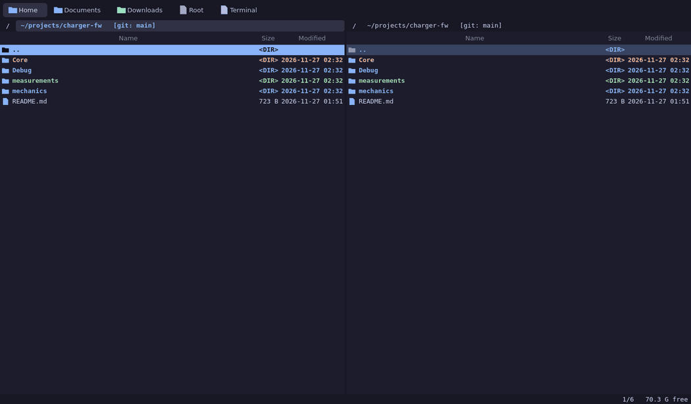

# VimCommander

**A two-pane graphical file manager you drive with vim keys.**

Total Commander's layout with vim's keyboard: counts, motions, registers, macros, marks, `:s` and `:g` on file names, and undo for file operations. `Ctrl-q` turns the other pane into a live preview of code, images, PDFs, Markdown, CSV and LTspice plots, JSON / YAML trees, Jupyter notebooks, firmware memory maps (`.map`, `.elf`), STM32CubeMX projects and STEP / STL 3D models. All four [Catppuccin](https://catppuccin.com) themes are built in.



## Install

```bash
pipx install vimcommander
vimcommander                  # or: vimcommander ~/projects ~/Downloads
```

Windows, macOS and Linux, Python 3.10 or newer. On Windows there is also a portable exe on the [releases page](https://github.com/vim4all/VimCommander/releases/latest).

## Learn more

- [README](https://github.com/vim4all/VimCommander#readme): screenshots, the cheat sheet and the full key reference
- [Release notes](https://github.com/vim4all/VimCommander/releases)
- [Issues](https://github.com/vim4all/VimCommander/issues) and [Discussions](https://github.com/vim4all/VimCommander/discussions)

MIT licensed.
